# lakehouse-demo 概要设计文档

> 文档类型：HLD（High-Level Design / 概要设计）
> 目标读者：架构师、技术负责人、跨团队协作开发者
> 真相源：本仓库源码（核对日期 2026-11-27）。所有 `〔FACT｜路径:行号〕` 为代码可验证事实，`〔INFER〕` 为 AI 推断，需人工校准。
> 本文重点：**每一项功能的数据从哪儿来、到哪儿去、怎么流转**。实现级细节（接口签名、完整错误码、函数级异常分支）不在本文范围，见后续 LLD。
> 路径缩写：`common/` = `platform-common/src/main/java/com/demo/lake/common/`；`spark-batch/BatchApp.java`、`spark-batch/job/X.java`、`batch/LakeJob.java` = `spark-batch/src/main/java/com/demo/lake/batch/...`；`query/`、`controller/`、`observability/`、`security/`、`support/`、`exception/`、`filter/`、`config/`，以及 `batch/service|store|model/`、`governance/model|service/` = `lake-service/src/main/java/com/demo/lake/server/...`；`lake-ui/src/...` 为前端源码相对路径。

---

## 1. 系统概述

### 1.1 系统定位与职责

lakehouse-demo 是一个**湖仓一体（Lakehouse）脚手架**：用 Spark 做批处理、Iceberg 做存储与表格式层、Trino 做即席查询，外层再包一个 Spring Boot 4 服务层把「查」和「跑」包装成 HTTP，并自带一个 Vue 3 控制台。目标是三条命令在本地跑通、不装 Hadoop/Docker 也能用；接集群时只改 3 项配置。〔FACT｜README.md:6-7〕

系统承担五类职责：

| 职责 | 承载模块 | 一句话 |
|---|---|---|
| 数据入湖与分层加工 | `spark-batch` + `platform-common` | 把上游落地文件洗成 bronze（ODS）→ silver（DWD）→ gold（ADS）三层 Iceberg 表，并做去重、演进、维护 |
| 即席查询与指标口径 | `lake-adhoc`（官方 trino-jdbc 薄封装 + `SqlParams` 预处理）+ `lake-service` 查询链路 | 让调用方通过 SQL 或语义指标查询湖表，默认只读、带配额 |
| 作业编排 | `lake-service` 批作业链路 | 把 9 个批作业包装成可触发、可排队、可跟踪、可恢复的 HTTP 作业 |
| 数据治理 | `platform-common` 治理域 + `spark-batch` 质量/保留作业 + `lake-service` 治理链路 | 资产目录、敏感分级与脱敏视图、写入级血缘、数据质量、保留审计 |
| 人机交互 | `lake-ui` 控制台 | 查询台 / 表浏览 / 批作业 / 指标 / 审计 / 数据治理 / 配置七个页面 + 登录页 |

### 1.2 系统上下文图（C4-style）

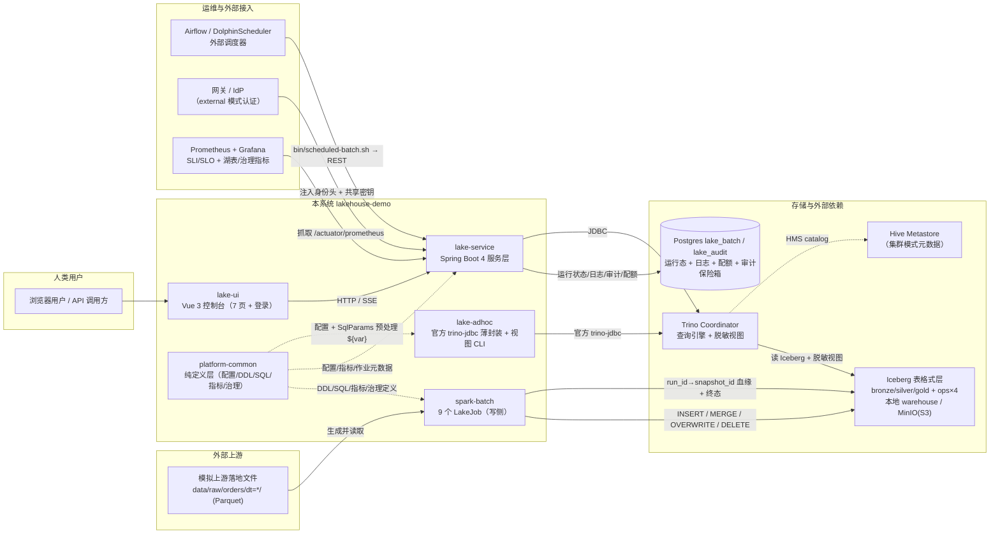

**关键外部边界**：① 上游落地文件是「模拟」的，由 IngestJob 自己生成；② Trino 是查询侧唯一入口，Spark 是写入侧主力；③ Postgres 只服务 lake-service 的运行态/审计/配额，不是湖仓数据的一部分；④ 外部调度器/网关/监控都只通过服务层接口接入，不直接碰湖表或运行态库。〔FACT｜README.md:6-7,9-24,115〕〔FACT｜batch/store/RunStateStore.java:10-13〕〔FACT｜scheduler/README.md:1-6〕

### 1.3 技术栈摘要

| 组件 | 版本 | 角色 |
|---|---|---|
| JDK | 17（批处理字节码）/ 21（服务层） | Spark 4.1 要求 Java 17+，服务层用 21 |
| Spark | 4.1.4 (Scala 2.13) | 批处理；`CollectionConverters` 已原生，无需 compat |
| Iceberg | 1.11.0 | 表格式层，format-version=2，CoW |
| Trino | 476 | 即席查询（官方 JDBC） |
| Spring Boot | 4.2.0 | WebFlux + Actuator（Reactor Netty）、spring-jdbc |
| Vue | 3.5 + Vite 7 | 控制台，构建产物进 `static/ui/` |
| 存储 | 本地 Hadoop catalog / MinIO(S3) | 由 `platform.warehouse` 决定 |
| 运行态库 | Postgres | `lake_batch.*` 与 `lake_audit.query_text` |
| 监控 | Micrometer 1.18.0 + Prometheus 2.54.1 + Grafana 11.6.0 | `/actuator/prometheus` + 可选 `monitoring` profile |
| 外部调度 | Airflow 2+ / DolphinScheduler / crontab | 经 REST 触发，不直连 Spark |
| 存储清理 | bucket lifecycle + `remove_orphan_files` + `RetentionJob` | S3/MinIO 孤儿文件与按保留天数的分区删除 |

〔FACT｜README.md:26-38〕〔FACT｜pom.xml:27-52〕〔FACT｜infra/docker-compose.yml:169,191〕

> Spark 4.1 / Iceberg 1.11 兼容性开关注入在 `sparkConf()`：`spark.sql.ansi.enabled=false`、`spark.sql.legacy.parameterSubstitution.constantsOnly=true`（SPARK-59672 的 `?` 参数绑定兜底）、关闭 s3a Magic Committer、UTC 时区。不要删除。〔FACT｜common/config/PlatformConfig.java:141-190〕

### 1.4 仓库目录结构（第一级）

> 只列第一级目录，说清各自职责。是否入库以 `.gitignore` 为准。〔FACT｜.gitignore:1-35〕

| 目录 | 做什么的 | 入库 |
|---|---|---|
| `platform-common/` | **公共定义层**：归一化配置、8 个 DDL 模板（2 建库 + 7 建表，含 3 张治理 ops 表）、4 个脱敏视图模板、转换/迁移/质量 SQL、指标目录、作业元数据、治理目录、`SqlParams` 预处理。零框架依赖。 | ✅ |
| `lake-adhoc/` | **即席查询薄封装**：`SqlParams` 预处理 + 官方 `trino-jdbc` 执行 + `TableFormatter` 表格输出；`TrinoViews` 在纯 Trino 环境建脱敏视图。 | ✅ |
| `spark-batch/` | **批处理写侧**：9 个 Spark 作业（init / ingest / transform / evolve / maintain / show / verify-sql / quality / retention），外加 `LineageWriter` 写写入级血缘。 | ✅ |
| `lake-service/` | **服务层**：Spring Boot 4 应用，查询/语义/批作业/审计/治理 REST + SSE，内置 Vue 控制台静态资源与状态库 DDL。 | ✅ |
| `lake-ui/` | **控制台前端**：Vue 3 + Vite 源码（7 个路由页 + 登录页），构建产物写进 `lake-service` 的 `static/ui/`。 | ✅（源码）/ ❌（产物） |
| `bin/` | **便捷脚本（13 个）**：build、build-ui、dev-batch、infra、init-views、install-docker、lake-service、scheduled-batch、smoke、stack、storage-lifecycle、submit-batch、trino-query；分类见 §1.5。 | ✅ |
| `.github/workflows/` | **CI 与安全门禁**：ci（构建/单测/前端/脚本静态校验 + 主分支 E2E）、codeql、dependency-review；CodeQL 排除测试源码。 | ✅ |
| `scheduler/` | **外部调度接入示例**：Airflow DAG（每日 ingest→transform / 单独 maintain）、DolphinScheduler 入口。 | ✅ |
| `conf/` | **配置**：`platform.properties.example`（模板）、本地 `platform.properties`（含密钥，不提交）、`platform.stack.properties`（stack.sh 生成，不提交）。 | 模板 ✅ / 本地 ❌ |
| `sql/` | **即席查询脚本**：`sql/adhoc/*.sql`，可直接交 Trino，也可经方言适配用 Spark 校验。 | ✅ |
| `infra/` | **基础设施编排**：Docker Compose（Postgres + MinIO + HMS + Trino）、全栈 override、监控 profile、安全模板、存储生命周期规则。 | ✅ |
| `docs/` | **项目文档**：本 HLD（`docs/lakehouse-demo/`）与 `ARCHITECTURE.md` / `CODING_STANDARDS.md` / `GLOSSARY.md` / `NAMING.md` / `OBSERVABILITY.md` / `SECURITY.md` / `CONCURRENCY.md` / `STORAGE.md`。 | ✅ |
| `config/` | **静态门禁配置**：Checkstyle 命名规则（`naming.xml` / `naming-suppressions.xml`），绑定 `mvn validate`。 | ✅ |
| `warehouse/` | **Iceberg 本地存储根**：Hadoop catalog 模式下 `warehouse/<database>.db/<table>/metadata|data/`；集群模式走 `s3a://lake/warehouse`。 | ❌ |
| `data/` | **模拟上游落地文件**：`data/raw/orders/dt=*/` 的 Parquet，由 IngestJob 生成。 | ❌ |
| `logs/` | **运行日志**：`audit.log`、批作业 `batch/`、`lake-service.log`。 | ❌ |
| `spark-warehouse/` | Spark SQL 默认本地临时仓库，当前为空。 | ❌ |
| `.mvn/` | `jvm.config`：JDK 17+ 反射所需 `--add-opens`。 | ✅ |
| `.idea/` / `.workbuddy/` / `.Trash-0/` | IDE 与工具残留，与项目本身无关。 | ❌ |

根目录文件：`pom.xml`（Maven reactor 入口，4 个模块）、`README.md`、`AGENTS.md`、`CONTRIBUTING.md`、`lombok.config`、`.gitignore`、`.dockerignore`、`.editorconfig`。

### 1.5 脚本与工具清单（按用途分类）

`bin/` 下 13 个脚本按「谁用、什么时候用」分成 7 类：〔FACT｜bin/README.md〕

#### 1.5.1 构建与打包（改代码后跑一次）

| 脚本 | 作用 | 前置 / 产出 |
|---|---|---|
| `bin/build.sh` | 全量构建 reactor：前端 → 4 个模块 jar → 预生成 `spark-batch`/`lake-adhoc` 两个 classpath | JDK 21；支持 `-DskipTests`、`-pl <module> -am`〔FACT｜bin/build.sh:81-99〕 |
| `bin/build-ui.sh` | 只构建 Vue 控制台，产物写进 `lake-service/src/main/resources/static/ui` | Node 18+；`--clean` 先重装 `node_modules` |

#### 1.5.2 本地开发运行（人直接跑）

| 脚本 | 作用 | 说明 |
|---|---|---|
| `bin/dev-batch.sh` | 用预构建 classpath 起 Spark 作业：`--job all/ingest/transform/evolve/quality/maintain/retention/show/verify-sql` | 必须先 `bin/build.sh`；CLI 直跑自动 `tee` 到 `logs/batch/{runId}.log` |
| `bin/lake-service.sh` | 服务层 `build / run / start / stop` | 默认 8088；后台日志 `logs/lake-service.out`；需要 JDK 21 |

#### 1.5.3 环境与全栈（运维）

| 脚本 | 作用 | 说明 |
|---|---|---|
| `bin/infra.sh` | 起停本地 infra：`up [trino\|tools\|monitoring\|all]`、`core`、`stop`、`restart`、`down`、`clean`、`ps`、`logs`、`doctor`、`psql` | 只管 Docker 容器，默认只起 Postgres + MinIO〔FACT｜bin/infra.sh:37-48〕 |
| `bin/install-docker.sh` | 一次性安装 Docker Engine + Compose v2 + buildx | Ubuntu 22.04/24.04、Debian 12 |
| `bin/stack.sh` | 一键全栈：infra + 宿主机批处理 + 容器化 `lake-service`；子命令 `up/down/clean/smoke/batch/logs/ps/build` | 容器内关闭批作业（`LAKE_BATCH_ENABLED=false`），生成 `conf/platform.stack.properties` 不覆盖本地配置 |

#### 1.5.4 验证与质量（CI / 发布前）

| 脚本 | 作用 | 说明 |
|---|---|---|
| `bin/smoke.sh` | 端到端冒烟：健康/鉴权/查询/SSE/语义/批作业/审计/治理/只读守卫/指标抓取 | 宿主机约 28 项、容器约 25 项（含治理检查点；以脚本实际为准）；失败非零退出，`SMOKE_BATCH=0` 跳过批作业 |

#### 1.5.5 查询与分析（人 / 脚本直接读湖表）

| 脚本 | 作用 | 说明 |
|---|---|---|
| `bin/trino-query.sh` | 即席查询 CLI：`--sql` / `--sql-file` / `--params` / `--stats` / `--list` / `--explain` / `--print-only` / `--limit`，另有 `--server` / `--url` / `--user` / `--timeout` / `--fail-fast` | `java -cp` 直起 `lake-adhoc`，无鉴权/配额/审计，面向运维与本地脚本〔FACT｜lake-adhoc/TrinoQuery.java:168-186〕 |
| `bin/init-views.sh` | 在 Trino 侧创建/刷新 4 张脱敏视图（`com.demo.lake.adhoc.TrinoViews`） | 与 `LakeViewDdl` 共用 `sql/view/` 模板；依赖 `bin/build.sh` 产物 |

`sql/adhoc/*.sql` 是查询资产，不是可执行工具；`@trino-only` 语句由 `verify-sql` 跳过。

#### 1.5.6 调度与集群集成（机器调用）

| 脚本 / 文件 | 作用 | 说明 |
|---|---|---|
| `bin/scheduled-batch.sh` | 调度器 → `POST /api/batch/{job}`，按 `(job, 逻辑日期)` 生成幂等键；支持 `--no-wait` / `--poll` / `--dry-run` | 退出码 0/1/2 直接当调度任务状态〔FACT｜bin/scheduled-batch.sh:28-37,73-136〕 |
| `bin/submit-batch.sh` | 直接 `spark-submit` 到已有 YARN / K8s / standalone 集群 | 绕过 lake-service |
| `scheduler/airflow/dag_lakehouse_daily.py` | 每日 `ingest → transform` DAG | 调 `scheduled-batch.sh`，不直跑 Spark |
| `scheduler/airflow/dag_lakehouse_maintain.py` | `maintain` 单独定时 DAG | 避免和写入抢资源 |
| `scheduler/dolphinscheduler/run_lake_job.sh` | DolphinScheduler SHELL 任务入口 | 参数：作业名 + 业务日期 |

#### 1.5.7 存储治理（对象存储管理员）

| 脚本 | 作用 | 说明 |
|---|---|---|
| `bin/storage-lifecycle.sh` | 把 `infra/storage/lifecycle.json` 应用到 S3 / MinIO bucket | 需要 AWS CLI v2；`--dry-run` 只打印 |

**怎么记**：`build*` 是构建期工具；`dev-batch` / `lake-service` / `trino-query` / `init-views` 是给人用的本地工具；`infra` / `stack` / `storage-lifecycle` 是运维工具；`smoke` 是 CI / 发布检查；`scheduled-batch` / `submit-batch` / `scheduler/*` 是机器接口。

---

## 2. 架构总览

### 2.1 架构风格

系统采用**分层 + 旁路编排**的混合风格：

- **写侧（批处理）**：以 `platform-common` 为纯定义内核，`spark-batch` 为执行器，围绕 Iceberg 三层表构建一条 ETL 流水线，并在每个作业后旁路写血缘/质量/审计。
- **读侧（服务）**：WebFlux 响应式服务层，查询走 Trino、编排走子进程或 K8s Job，所有阻塞 IO offload 到虚拟线程。
- **旁路记账**：运行态写 Postgres、历史/治理归档写湖表，二者通过 runId 对齐、通过对账互相恢复。
- **治理**：静态治理目录（资产/敏感级别/保留天数/SLA）+ SQL 注释里的血缘声明 + 运行期落表证据，服务层统一以只读 API 暴露。
- **前端**：单页应用与接口同源托管，hash 路由，长任务用 SSE。

### 2.2 分层架构图

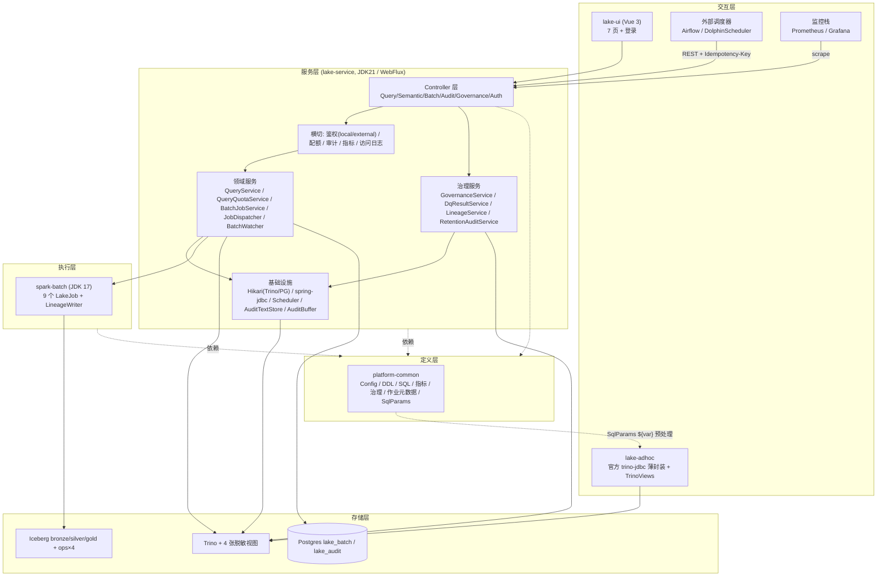

`platform-common` 是唯一被三层共同依赖的模块，且自身不依赖 Spark/Spring/Trino（pom 只有 lombok/slf4j/junit），因此是「纯定义层」。〔FACT｜platform-common/pom.xml:17-30〕

### 2.3 全局数据流总图（核心）

下图是全文骨架——所有功能的数据流归到六条主干：

```mermaid
flowchart LR
    CFG["配置源<br/>platform-defaults → conf/platform.properties → LAKE_* → -D"] -->|"PlatformConfig"| PC["配置对象"]
    PC -->|"sparkConf()"| SS["SparkSession"]
    PC -->|"trinoJdbcUrl()"| DS["Hikari 连接池"]

    RAW["模拟上游 Parquet<br/>data/raw/orders/dt=*"] -->|"① 生成+读取"| ING["IngestJob"]
    ING -->|"② INSERT 追加"| BRONZE[("bronze_orders<br/>ODS")]
    BRONZE -->|"③ MERGE 去重"| SILVER[("silver_orders<br/>DWD")]
    SILVER -->|"④ INSERT OVERWRITE 聚合"| GOLD[("gold_daily_revenue<br/>ADS")]

    GOLD -->|"Trino 读"| Q["查询链路<br/>SQL / 语义指标 / 脱敏采样"]
    Q -->|"SSE meta/rows/done"| UI["Vue 控制台"]
    Q -.->|"审计指纹+保险箱"| AUDIT["audit.log + Postgres lake_audit"]

    UI -->|"POST /api/batch/{job}"| SUB["作业提交 → QUEUED"]
    SUB -->|"Postgres"| RS[("lake_batch.batch_runs<br/>运行态")]
    RS -->|"Dispatcher 认领"| EXEC["子进程 BatchApp / K8s Job"]
    EXEC -->|"BATCH_RUN_ID 注入"| SPARK["spark-batch"]
    EXEC -->|"日志尾部"| LOG[("lake_batch.batch_log_lines")]
    SPARK -->|"终态 + run_id→snapshot_id 血缘"| OPS[("ops.batch_runs / lineage_runs")]
    RS -.->|"对账恢复"| OPS

    GOV["治理作业<br/>QualityJob / RetentionJob"] -->|"检查结果 / 保留审计"| GOPS[("ops.dq_results / retention_audit")]
    GOPS -->|"Trino 读"| GV["GET /api/governance/*<br/>治理页 + Prometheus 告警"]
```

**六条主干**：① 配置流；② 数据入湖流；③ 分层加工流；④ 查询流；⑤ 作业编排流；⑥ 治理流。下文第 4 章逐一展开。

### 2.4 请求处理主链路（服务层）

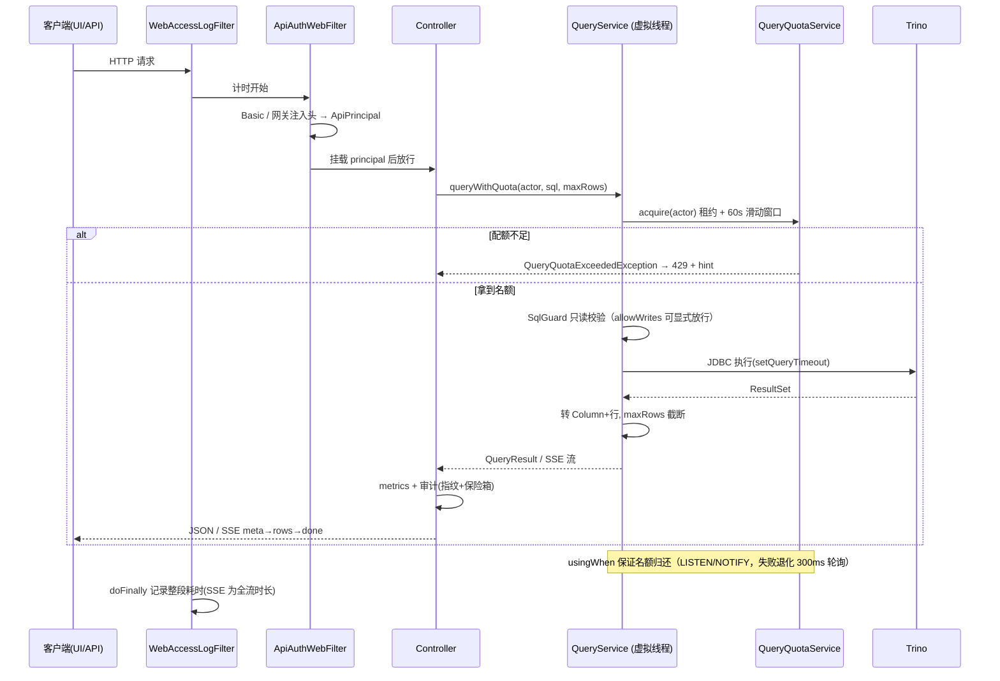

所有阻塞点（Hikari 取连接、`rs.next()`、子进程等待）均 `subscribeOn(blocking)` 到虚拟线程，Netty 事件循环只负责编排与订阅。〔FACT｜config/LakeConfiguration.java:48-64〕〔FACT｜query/service/QueryService.java:81,90,262,290,304〕

---

## 3. 模块划分

### 3.1 platform-common —— 公共定义层

- **职责**：产出「配置对象、表 DDL、SQL 模板、指标定义、治理目录、作业元数据、runId」，自身不搬运数据。〔FACT｜platform-common/pom.xml:17-30〕
- **对外接口（数据视角）**：
  - 输入：配置文件 / 环境变量 / JVM 参数；输出：`PlatformConfig` 对象。〔FACT｜common/config/PlatformConfig.java:22-29,44-61〕
  - 输入：`PlatformConfig`；输出：2 条建库 + 7 条建表 DDL、4 条脱敏视图模板、2 条转换 SQL、5 条迁移模板、6 条质量 SQL、指标目录、作业清单（SQL 文本来自外置模板）。〔FACT｜common/catalog/LakeTables.java:37-70〕〔FACT｜common/sql/SqlResources.java:19-52〕
- **依赖**：仅 lombok / slf4j / junit，零框架依赖。
- **关键约束**：指标目录是**编译期硬编码**（`SemanticCatalog.METRICS`，5 个指标），新增指标需改代码重新构建；治理资产定义同样编译期硬编码（`GovernanceCatalog.ASSETS`）。〔FACT｜common/semantic/SemanticCatalog.java:12-26〕

### 3.2 spark-batch —— 批处理写侧

- **职责**：跑 DDL、入湖、去重加工、质量检查、schema 演进、表维护、保留治理、巡检、SQL 校验，并把每次运行终态归档到湖表，同时写写入级血缘。〔FACT｜spark-batch/BatchApp.java:44-57〕
- **对外接口**：`BatchApp` 命令行入口（`--job` / `--days` / `--evolve` / `--run-id` / `--inject-faults` / `--execute` / `--retention-days` …）；内部统一 `LakeJob.run(SparkSession, PlatformConfig, Args)`。〔FACT｜spark-batch/BatchApp.java:62-118〕〔FACT｜batch/LakeJob.java:7-12〕
- **依赖**：`platform-common`（配置/DDL/SQL/作业名/治理目录）。
- **关键约束**：9 个作业复用同一个 SparkSession；记账（终态 + 血缘）必须在 `spark.stop()` 之前完成；`--job all` = init → ingest → transform → [evolve] → quality → maintain → show。〔FACT｜spark-batch/BatchApp.java:83-116,124-139〕

### 3.3 lake-adhoc —— 即席查询薄封装

即席查询以 **`lake-adhoc` 模块**承载：协议层完全用**官方 `trino-jdbc` 驱动**（与 lake-service 查询链路同一套官方 client），项目只保留 `${var}` 参数化业务约定、表格显示层和视图建表 CLI。原 `trino-adhoc` 已删除。〔FACT｜lake-adhoc/pom.xml:27-34〕〔FACT｜common/cli/SqlParams.java:15-18〕

- **职责**：一次 JVM 内完成「`SqlParams` 预处理 → 官方 `trino-jdbc` 执行 → `TableFormatter` 表格输出」；`TrinoViews` 负责在 Trino 侧建脱敏视图。〔FACT｜lake-adhoc/TrinoQuery.java:17-23〕
- **对外接口**：`bin/trino-query.sh --sql-file/--sql/--list/--params/--explain/--print-only/--stats/--limit/--server/--url/--user/--timeout/--fail-fast`；`bin/init-views.sh [--print-only]`。〔FACT｜lake-adhoc/TrinoQuery.java:168-186〕
- **依赖**：`platform-common`（配置 + `SqlParams` + `LakeViews`）；官方 `trino-jdbc`。默认连接 URL 取 `PlatformConfig.trinoJdbcUrl()`，可被 `--url` / `--server` 覆盖。〔FACT｜lake-adhoc/TrinoQuery.java:125-140〕
- **关键约束**：连接固定 `timezone=UTC`、`setReadOnly(true)`；`${var}` 替换与缺参跳过由 `SqlParams` 保证；客户端 `--limit` 默认 200 截断，不依赖 SQL 的 `LIMIT`。〔FACT｜lake-adhoc/TrinoClient.java:32-44〕〔FACT｜common/cli/SqlParams.java:27-49〕

### 3.4 lake-service · 查询链路

- **职责**：把 SQL 查询、语义指标查询包装成 HTTP（JSON + SSE），负责鉴权、只读校验、配额编排、审计与指标；配额编排收在 `QueryService` 的 `*WithQuota` 方法内，Controller 不再直接依赖 `QueryQuotaService`。
- **对外接口**：`POST /api/query`、`POST /api/query/stream`、`GET/POST /api/semantics*`、`GET /api/tables*` + `/api/tables/{table}/sample`、`GET /api/config`、`GET /api/audit*`、`GET /api/auth/session`、`POST /api/auth/login`。〔FACT｜README.md:157-168〕〔FACT｜controller/AuthController.java:50,89〕
- **依赖**：`platform-common`（配置 + 指标 + 脱敏目录）；Trino（JDBC）、Postgres（审计保险箱 + 配额租约/事件）。
- **关键约束**：SQL 默认只读（`SqlGuard` 白名单，`allowWrites` 可显式放开），配额满返回 429，Trino 挂返回 503，健康检查如实报 DOWN。〔FACT｜query/service/SqlGuard.java:19-22,48-68〕

### 3.5 lake-service · 批作业编排链路

- **职责**：把 batch 作业包装成可提交、可排队、可跟踪、可恢复、跨实例共享状态的 HTTP 作业。
- **对外接口**：`POST /api/batch/{job}`、`GET /api/batch/runs[/{id}]`、`GET /api/batch/runs/{id}/events`。〔FACT｜controller/BatchController.java:43-74〕
- **依赖**：`platform-common`（runId / 作业白名单）；Postgres（运行态+日志+锁）、Trino（读湖表历史）、本地进程或 K8s（执行）。数据库访问统一用 `spring-jdbc` 的 `JdbcTemplate` / `TransactionTemplate`（`LakeConfiguration.stateJdbc` / `stateTx`）。〔FACT｜lake-service/pom.xml:65-68〕〔FACT｜config/LakeConfiguration.java:109-131〕
- **关键约束**：请求线程不直接 fork 子进程，只落 QUEUED；白名单取 `lake.batch.allowed-jobs`（默认 `LakeJobs.CHOICES`，9 个）；幂等键与 QUEUED 在同一事务内抢占；Dispatcher 在数据库行锁内检查名额并认领，多实例共享并发上限（默认 2）。〔FACT｜batch/service/BatchJobService.java:139-199〕〔FACT｜batch/service/JobDispatcher.java:61-87〕

### 3.6 lake-service · 数据治理链路

- **职责**：以只读 API 暴露资产目录、质量结果、血缘与保留审计；配合脱敏视图与治理指标形成「定义 → 证据 → 展示/告警」闭环。
- **对外接口**：`GET /api/governance/assets`、`/dq`、`/lineage`、`/retention`；`GET /api/tables/{t}/sample` 按角色选视图；`GET /api/audit/sql/{id}` 与 `POST /api/audit/sql/{id}/hold`。〔FACT｜controller/GovernanceController.java:25-65〕〔FACT｜controller/AuditController.java:40-92〕
- **依赖**：`platform-common`（`GovernanceCatalog` / `MaskingCatalog` / `LineageCatalog` / `QualityChecks`）；Trino（查湖表 ops 与视图）；`IcebergTableMetrics` 的快照缓存。
- **关键约束**：治理接口全部只读且需要 QUERY 角色；原文调阅需 AUDITOR 且每次再写一条审计；脱敏档位按角色映射，不信任客户端参数。〔FACT｜common/governance/MaskingCatalog.java:26-71〕

### 3.7 lake-ui —— Vue 3 控制台

- **职责**：7 个路由页（查询台 / 表浏览 / 批作业 / 指标 / 审计 / 数据治理 / 配置）+ 登录页，与接口同源托管（8088），hash 路由。〔FACT｜lake-ui/src/router.js:14-59〕
- **对外接口**：调用 `lake-service` 的 HTTP/SSE；自身无后端。登录走公开 `/api/auth/login`，凭据在内存中给后续请求（含 SSE）加 Basic 头。〔FACT｜lake-ui/src/App.vue:19-20〕
- **依赖**：`/api/config` 下发作业卡片、表 FQN 等元数据，前端不硬编码；治理徽标来自 `/api/governance/assets`。〔FACT｜lake-ui/src/store.js:15-41〕〔FACT｜controller/QueryController.java:178-205〕
- **关键约束**：全局状态在内存（Vue reactive），**只有 SQL 草稿写 localStorage**，查询结果只在内存不落盘。〔FACT｜lake-ui/src/views/QueryView.vue:74,149〕〔FACT｜README.md:280〕

### 3.8 工程化支撑与外部接入（非业务模块）

- **CI / 全栈 / 冒烟 / 安全门禁**：`.github/workflows/ci.yml` 跑构建、单测、前端打包与脚本/DAG/JSON 静态校验，主分支跑 E2E；`codeql.yml` + `dependency-review.yml` 做安全扫描与依赖门禁；根 pom 把 Checkstyle 命名规则绑到 `mvn validate`，`lake-service` 的 `NamingArchitectureTest` 用 ArchUnit 守住领域包分层。〔FACT｜config/checkstyle/naming.xml〕〔FACT｜lake-service/src/test/java/com/demo/lake/server/NamingArchitectureTest.java〕
- **服务层鉴权扩展**：`local` 静态账号用于 demo（viewer/operator/analyst/auditor），`external` 模式改由网关注入身份头 + 共享密钥，无密钥 fail closed。
- **可观测性**：Micrometer + Prometheus registry 暴露 `/actuator/prometheus`，可选 `monitoring` profile；`IcebergTableMetrics` 补湖表指标，`GovernanceMetrics` 补新鲜度/质量指标与告警。
- **外部调度**：`bin/scheduled-batch.sh` 是调度器与服务之间的薄契约，Airflow/DolphinScheduler/crontab 都通过它触发作业。
- **存储治理**：Iceberg 表属性 + bucket lifecycle + `remove_orphan_files` 三层清理，另有 `RetentionJob` 按资产目录保留天数删除旧分区并写审计。

---

## 4. 关键数据流详解（本文核心）

> 每个功能统一按「数据从哪儿来 → 经过什么处理 → 到哪儿去」三段式描述，并附数据流向图。

### 4.1 配置流：所有模块的输入源头

**从哪儿来**：五级覆盖，后者覆盖前者——
① classpath 内置 `platform-defaults.properties` → ② 工作目录 `conf/platform.properties`（存在且可读才加载）→ ③ `--conf` 指定的文件 → ④ 环境变量 `LAKE_*`（双下划线表连字符，如 `LAKE_S3_ACCESS__KEY`→`platform.s3.access-key`）→ ⑤ JVM `-Dplatform.*`（最高优先级）。〔FACT｜common/config/PlatformConfig.java:22-29,44-61,264-290〕

**怎么流转**：`PlatformConfig.load()` 输出一个配置对象，并做三类归一化：
- `warehouse()`：相对路径转 `file:///abs/path`，URI 原样保留并补尾 `/`；〔FACT｜common/config/PlatformConfig.java:107-115〕
- `sparkConf()`：生成 Iceberg extensions/catalog/warehouse、S3FileIO + endpoint/ak/sk/region、UTC 时区、动态分区覆盖、AQE 全套参数，以及 Spark 4.1 / Iceberg 1.11 三项兼容开关（ANSI 关闭、参数替换常量化、s3a Magic Committer 关闭）；〔FACT｜common/config/PlatformConfig.java:141-190〕
- `trinoJdbcUrl()`：若配置 `platform.trino.url` 则原样返回，否则拼 `jdbc:trino://host:port/catalog/database`。〔FACT｜common/config/PlatformConfig.java:214-222〕

**到哪儿去**：

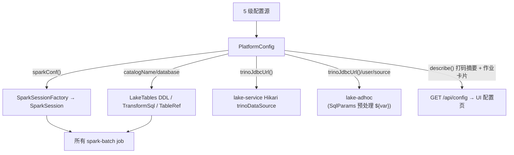

命令行覆盖必须在配置加载**之前**通过 `System.setProperty` 写入（系统属性优先级最高）。〔FACT｜spark-batch/BatchApp.java:69-81〕

服务层另有 `application.yml` 的 `lake.*` 配置（查询上限/鉴权账号/配额/审计保险箱/作业模板/状态库地址/治理指标/K8s 执行器），由 `LakeProperties` 绑定，与 `platform.*` 分工明确：前者管「服务怎么跑」，后者管「连哪个湖」。〔FACT｜common/config/PlatformConfig.java:19-29〕〔FACT｜lake-service/config/LakeProperties.java:12-24〕〔FACT｜lake-service/src/main/resources/application.yml:44-126〕

### 4.2 建表流（init）：定义 → 库表

**从哪儿来**：DDL 文本外置在 `platform-common/src/main/resources/sql/ddl/`，由 `LakeTables.all(cfg)` 读模板并绑定配置。**当前 8 个模板 / 9 条语句**：建库 2 条（`lake` + `ops`）→ 业务表 bronze / silver / gold 3 条 → 运维表 `ops.batch_runs` / `ops.dq_results` / `ops.lineage_runs` / `ops.retention_audit` 4 条。表名常量由 Java 持有，单测校验模板与常量不漂移；另有 4 个脱敏视图模板（`sql/view/`）供 Trino 侧建视图。〔FACT｜common/catalog/LakeTables.java:37-70〕〔FACT｜common/sql/SqlResources.java:19-31〕

**怎么流转**：`InitJob` 逐条 `spark.sql(ddl)`（全部 `IF NOT EXISTS`，幂等可重跑），随后 `prepareBatchRuns()` 用 `Migrations` 的 V1a/V1b 模板给老表补 `started_ms/finished_ms` 列并按 UTC 墙钟回填（列是否存在、是否有旧行的判断留在 Java），最后 `SHOW TABLES`。〔FACT｜spark-batch/job/InitJob.java:32-70〕〔FACT｜common/catalog/Migrations.java:40-50〕

**到哪儿去**：Iceberg catalog——本地默认 warehouse 下 `<database>.db/<table>/metadata|data/`（Hadoop catalog 布局），接集群为 `s3a://lake/warehouse`；表用三段式 `<catalog>.<database>.<table>` 寻址，运维表在 `<catalog>.ops.*`。〔FACT｜README.md:115〕〔FACT｜platform-common/src/main/resources/sql/ddl/10_bronze_orders.sql:4〕

> 设计约束：建库 DDL 故意**不带 COMMENT**，因为 Hadoop catalog 拒绝 namespace 元数据。〔FACT｜platform-common/src/main/resources/sql/ddl/00_databases.sql:1-4〕

### 4.3 入湖流（ingest）：落地文件 → ODS

这是数据「进系统」的入口，分两个阶段。

**阶段一：生成模拟上游落地文件**
- 从哪儿来：无真实上游，IngestJob 按 `days`（默认 7）× `orders-per-day`（默认 2000）用**业务日期作随机种子**生成，保证同一天重跑数据可复现。〔FACT｜spark-batch/job/IngestJob.java:84-86,141-153〕
- 到哪儿去：`data/raw/orders/dt=YYYY-MM-DD/`，每天一个目录，Parquet + snappy，`mode("overwrite")` 整目录覆盖。〔FACT｜spark-batch/job/IngestJob.java:88-104〕
- 字段生成映射〔FACT｜spark-batch/job/IngestJob.java:62-76,141-171〕：

| 字段 | 生成规则 |
|---|---|
| `order_id` | `ORD-<dt>-<7位序号>`（带业务日期） |
| `user_id` / `merchant_id` | `U`+5位 / `M`+3位 |
| `category` | 从 5 类中随机（3C/FASHION/GROCERY/HOME/BEAUTY） |
| `amount` / `currency` | round(10+r*990,2) / 固定 CNY |
| `status` | 6% REFUNDED、4% CANCELLED、其余 PAID |
| `event_time` | 当天（或前一天）+ 随机小时 |
| **迟到数据 10%** | 10% 概率把 event_time 落到前一天 |
| **重复单 ~3%** | PAID 单再造一条 event_time+2h、status=REFUNDED 的记录 |

**阶段二：落地文件 → bronze_orders**
- 从哪儿来：只读本次生成的 dt 目录（`mergeSchema=true`）。〔FACT｜spark-batch/job/IngestJob.java:110-112〕
- 怎么流转：`INSERT INTO bronze SELECT 原字段 + current_timestamp() AS ingest_time + input_file_name() AS source_file + <runId> AS run_id`——**纯追加，不做更新**。〔FACT｜spark-batch/job/IngestJob.java:50-56,114-115〕
- 到哪儿去：`iceberg.lake.bronze_orders`。分区**不在 SQL 里指定**，由 Iceberg 依表定义 `days(event_time)` 自动按事件时间路由——迟到数据进正确的历史分区，与上游 dt 目录解耦。〔FACT｜platform-common/src/main/resources/sql/ddl/10_bronze_orders.sql:18〕〔FACT｜spark-batch/job/IngestJob.java:25-35〕
- 老表升级：缺 run_id 列则 `ADD COLUMNS`，并删掉 run_id 为空的历史行；走迁移模板 `V3__bronze_add_run_id.sql`，由 `Migrations.addBronzeRunId` 装载。〔FACT｜spark-batch/job/IngestJob.java:121-138〕〔FACT｜common/catalog/Migrations.java:62-65〕

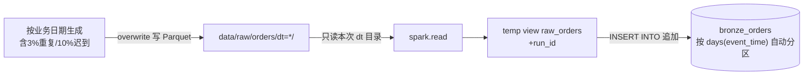

> 设计取舍：ODS 只追加、不幂等；幂等收敛交给 DWD 的 MERGE。〔FACT｜spark-batch/job/IngestJob.java:33-35〕

### 4.4 分层加工流（transform）：ODS → DWD → ADS

`--days`（默认 7）只扫近 N 天分区，靠 Iceberg 分区裁剪控制扫描量。〔FACT｜spark-batch/job/TransformJob.java:34-42〕

**第一步：bronze → silver（MERGE 去重）**〔FACT｜common/catalog/TransformSql.java:21-29〕
- 从哪儿来：bronze 近 N 天（`event_time >= current_date() - INTERVAL days DAYS`）。
- 怎么流转：内层 `row_number() OVER (PARTITION BY order_id ORDER BY event_time DESC, ingest_time DESC)` 只取 `rn=1`（同一订单取最新事件）；派生 `is_refund = status='REFUNDED'`、`dt = cast(event_time as date)`、`updated_at = current_timestamp()`；按 `order_id` 匹配，`WHEN MATCHED AND s.event_time > t.event_time` 更新、`WHEN NOT MATCHED` 插入。
- **关键约束**：SQL **显式列出全部列**（MATCHED 更新 10 列、NOT MATCHED 插入 11 列），**不写 `UPDATE SET *` / `INSERT *`**——silver 会被 evolve 加列（`channel`），用 `*` 时 target 多出来的列解析不到，transform 会直接失败；`SqlResourcesTest` 有守卫单测。〔FACT｜platform-common/src/main/resources/sql/transform/bronze_to_silver.sql:4-6,32-49〕
- 到哪儿去：`silver_orders`（增量 upsert，只更新真正变了的行）。

**第二步：silver → gold（INSERT OVERWRITE 汇总）**〔FACT｜common/catalog/TransformSql.java:31-41〕
- 从哪儿来：silver，过滤 `status <> 'CANCELLED'`（取消单不计入）。
- 怎么流转：按 `dt, merchant_id, category` 聚合：

| 输出字段 | 口径 |
|---|---|
| `dt` / `merchant_id` / `category` | 分组键（也是分区与主键） |
| `order_cnt` | `count(*)` |
| `buyer_cnt` | `count(DISTINCT user_id)`（该粒度下去重，**跨行不可相加**） |
| `gmv` | `sum(amount)` |
| `refund_amount` | `sum(CASE WHEN is_refund THEN amount ELSE 0 END)` |
| `net_revenue` | `sum(CASE WHEN is_refund THEN 0 ELSE amount END)`（GMV−退款） |
| `updated_at` | `current_timestamp()` |

- 到哪儿去：`gold_daily_revenue`，`INSERT OVERWRITE` + Iceberg 动态分区覆盖（只替换出现的分区），同样显式列清单。〔FACT｜platform-common/src/main/resources/sql/transform/silver_to_gold.sql:2,4-5,19-33〕

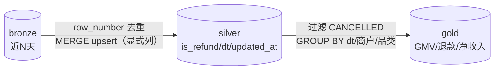

### 4.4a 数据质量流（quality）

- 从哪儿来：`common/quality/QualityChecks` 登记的 6 项检查（silver 唯一性 / 非空 / 金额范围，gold 退款率 0~1 / 净收入一致性 / 行数波动），SQL 外置在 `sql/quality/01..06_*.sql`。〔FACT｜common/sql/SqlResources.java:47-52〕
- 怎么流转：`QualityJob.run()` 逐项 `spark.sql()` 得到 observed / threshold / detail，`observed > threshold` 即失败；`snapshot_id` 按来源表 `committed_at` 最新快照取，让结果能定位数据版本；`--inject-faults` 用于演示注入脏数据。ERROR 失败会抛异常让作业落 FAILED，WARN 只记录。〔FACT｜spark-batch/job/QualityJob.java:41-82,83〕
- 到哪儿去：`ops.dq_results` 一行一检查（run_id 与 `ops.batch_runs` 对齐）；`GET /api/governance/dq` 展示证据并可点 run_id 跳作业日志；`GovernanceMetrics.collectQuality()` 读同一份结果打 gauge 并触发告警。〔FACT｜platform-common/src/main/resources/sql/ddl/50_ops_dq_results.sql:6-14〕〔FACT｜observability/service/GovernanceMetrics.java:97-147〕

> `all` 链路把 quality 放在 maintain/show 之前，作为链路验收：脏数据在这里阻断，不让它悄悄流到巡检结果里。〔FACT｜spark-batch/BatchApp.java:124-139〕

### 4.4b 写入级血缘流（lineage）

- 从哪儿来：两层定义——`LineageCatalog` 声明哪些作业算写表（仅 ingest/transform/evolve，init/maintain 不记）；`bronze_to_silver.sql` / `silver_to_gold.sql` 头部的 `@lineage table/column` 注释由 `LineageParser` 解析成表级/列级边。〔FACT｜platform-common/src/main/resources/sql/transform/bronze_to_silver.sql:8-18〕〔FACT｜platform-common/src/main/resources/sql/transform/silver_to_gold.sql:7-18〕
- 怎么流转：`BatchApp` 在每个作业后调 `LineageWriter.record(runId, job)` → 取该表 Iceberg 元数据里 `committed_at` 最新的快照 ID（Iceberg 1.11 的 `snapshot_id` 是随机 UUID，不能用 `max`）→ 写 `ops.lineage_runs`。表不存在、快照读不到、写入失败都只记日志，不影响作业结果。〔FACT｜spark-batch/LineageWriter.java:28-67〕
- 到哪儿去：`GET /api/governance/lineage` 合并设计级列级边与运行级 `run_id → table → snapshot_id`，治理页展示血缘卡片，快照 ID 可直接用于 Trino 时间旅行。〔FACT｜platform-common/src/main/resources/sql/ddl/60_ops_lineage_runs.sql:3-10〕

### 4.5 schema 演进流（evolve）

- 从哪儿来：`silver_orders`。
- 怎么流转：若未含 `channel` 列则 `ALTER TABLE ADD COLUMNS (channel STRING)`（纯元数据变更，走 `Migrations.addSilverChannel` / `V2a`）；再 `UPDATE silver SET channel = CASE pmod(hash(user_id),3) …`（按 user_id 哈希稳定分流 APP/MINI_APP/WEB，走 `V2b`），CoW 重写受影响数据文件；回填在列已存在时也会执行。〔FACT｜spark-batch/job/EvolveJob.java:15-19,31-43〕〔FACT｜common/catalog/Migrations.java:52-60〕
- 到哪儿去：仍是 silver 表的新快照；老快照只有旧列，读新快照缺值时自动返回 NULL。〔FACT｜spark-batch/job/EvolveJob.java:15-19〕

### 4.6 表维护流（maintain）

- 从哪儿来：三张业务表的数据文件与 Iceberg 元数据。
- 怎么流转：逐表执行四个 Iceberg `CALL system.*` 存储过程——① `rewrite_data_files`（合并小文件，min-input-files=2、target 32MB）；② `rewrite_manifests`（控元数据规模）；③ `expire_snapshots`（清理快照，`retain_last` 默认 5）；④ `remove_orphan_files`（清理没有被任何有效快照引用、且早于 `--orphan-retention-hours`（默认 168h）的孤儿文件）。顺序是先过期快照再清孤儿文件，否则刚过期的快照引用的文件还不敢删；存储过程表名用三段式 `<catalog>.<db>.<table>`。〔FACT｜spark-batch/job/MaintainJob.java:28-39,53-93〕
- 到哪儿去：重写后的数据文件、manifest、被裁剪的快照与孤儿文件（数据内容不变）。对象存储侧再配合 bucket lifecycle 清未完成分片与非当前版本，见 `docs/STORAGE.md`。〔FACT｜infra/storage/lifecycle.json:1-22〕

### 4.6a 保留治理流（retention）

- 从哪儿来：`GovernanceCatalog.ASSETS` 中每个资产的 `retentionDays`（90/365/730）与分区列映射。
- 怎么流转：`RetentionJob` 构造 `partition < date_sub(current_date(), days)`，**默认 dry-run** 只统计待删分区与行数；显式 `--execute` 才 `DELETE`；`--retention-days` 可覆盖单资产默认值。每张表前后各写一条 `retention.start` / `retention.done` 审计事件，stdout 同时打结构化 `AUDIT event=...` 行；审计写失败让作业 FAILED。〔FACT｜spark-batch/job/RetentionJob.java:31-35,42-97〕
- 到哪儿去：`ops.retention_audit`（含 dry_run / partitions / row_count / detail）；`GET /api/governance/retention` 展示审计卡片。〔FACT｜platform-common/src/main/resources/sql/ddl/70_ops_retention_audit.sql:3-11〕

### 4.7 即席查询流（SQL，JSON 接口）——读侧主干

**从哪儿来**：客户端 POST `/api/query` 的 `{sql, maxRows}`；账号名来自 `ApiPrincipal`（null 时回退 `anonymous`），IP 来自请求。〔FACT｜controller/QueryController.java:49-60,69-76,171-174〕

**怎么流转**：

```
HTTP {sql,maxRows}
  → WebAccessLogFilter（计时）→ ApiAuthWebFilter（Basic/网关注入头→ApiPrincipal）
  → QueryController → QueryService.queryWithQuota(actor, sql, maxRows)
     · QueryQuotaService.acquire：query_leases 租约 + query_events 60s 滑动窗口（超限 429）
     · SqlGuard 只读校验（allowWrites 可显式放行）→ Hikari trinoDataSource → Trino 执行
  → ResultSet 转 Column + List<List<String>>
     · maxRows = min(请求值, 服务端上限 1000，可由 lake.query.max-rows 覆盖)
     · 多读一行后置 truncated=true 并 break
     · 值格式化：BigDecimal→toPlainString、Timestamp→ISO 绝对时刻、byte[]→<binary NB>
  → QueryResult{columns, rows, rowCount, truncated, elapsedMs, stats}
  → 由 QueryController 的 doOnSuccess/doOnError 打 metrics + 审计（指纹）+ 可选保险箱
```

〔FACT｜query/service/QueryService.java:80-174,400-421〕〔FACT｜query/service/QueryQuotaService.java:65-70,115-122〕〔FACT｜controller/QueryController.java:69-95〕

**配额与限流状态库**：`QueryQuotaService` 在 `lake_batch.query_leases`（带过期租约）与 `query_events`（60 秒滑动窗口）落记录；名额释放走 Postgres `LISTEN/NOTIFY query_slot_free`，失败退化 300ms 轮询；多实例共享一份额度。〔FACT｜support/StateDbTables.java:17-19〕〔FACT｜lake-service/src/main/resources/sql/state/21_query_events.sql:2〕

**到哪儿去**：`QueryResult` JSON 返回客户端；同时三路副作用——Micrometer 指标（`/actuator/metrics`）、审计日志 `logs/audit.log` + 内存环形缓冲、Postgres `lake_audit.query_text` 原文保险箱（**可选，默认关闭；开启无密钥则启动失败**；写入前经 `SqlRedactor` 脱敏）。〔FACT｜observability/service/AuditService.java:29-45〕〔FACT｜observability/store/AuditTextStore.java:28-32,68-79,100-123〕

**只读校验 `SqlGuard`**：白名单放行 `select/with/show/describe/desc/explain`，拒绝多语句；`allowWrites` 配置可显式放开（demo 用）；因 `EXPLAIN ANALYZE` 会真实执行内层语句且 Trino JDBC 的 `setReadOnly` 只是驱动标记，只读模式会「看穿」内层递归校验（最多 5 层）。〔FACT｜query/service/SqlGuard.java:19-22,48-68〕

**采样与脱敏视图**：`GET /api/tables/{table}/sample` 按角色选目标表——AUDITOR 看基础表、ANALYST 看 `*_masked`、其余看 `*_restricted`；视图 SQL 在 `sql/view/`（user_id 做 SHA-256、order_id 截断、amount 分桶、merchant_id 按档位哈希/明文），由 `LakeViewDdl` 启动或 `bin/init-views.sh` 在 Trino 侧 `CREATE OR REPLACE VIEW`。〔FACT｜controller/QueryController.java:148-170〕〔FACT｜query/service/QueryService.java:293-320〕〔FACT｜common/governance/MaskingCatalog.java:26-71〕

### 4.8 语义指标流（semantics）

指标目录数据**来自静态定义** `SemanticCatalog.METRICS`（编译期硬编码），共 5 个指标，全部指向 `gold_daily_revenue`：〔FACT｜common/semantic/SemanticCatalog.java:12-26〕

| 指标 | 口径（measure） |
|---|---|
| `gmv` 成交总额 | `SUM(gmv)` |
| `orders` 有效订单数 | `SUM(order_cnt)` |
| `buyers` 下单人数 | `SUM(buyer_cnt)`（跨维度不可相加） |
| `net_revenue` 净收入 | `SUM(net_revenue)` |
| `refund_rate` 退款率 | `SUM(refund_amount) / NULLIF(SUM(gmv), 0)` |

三个 API 的数据流：

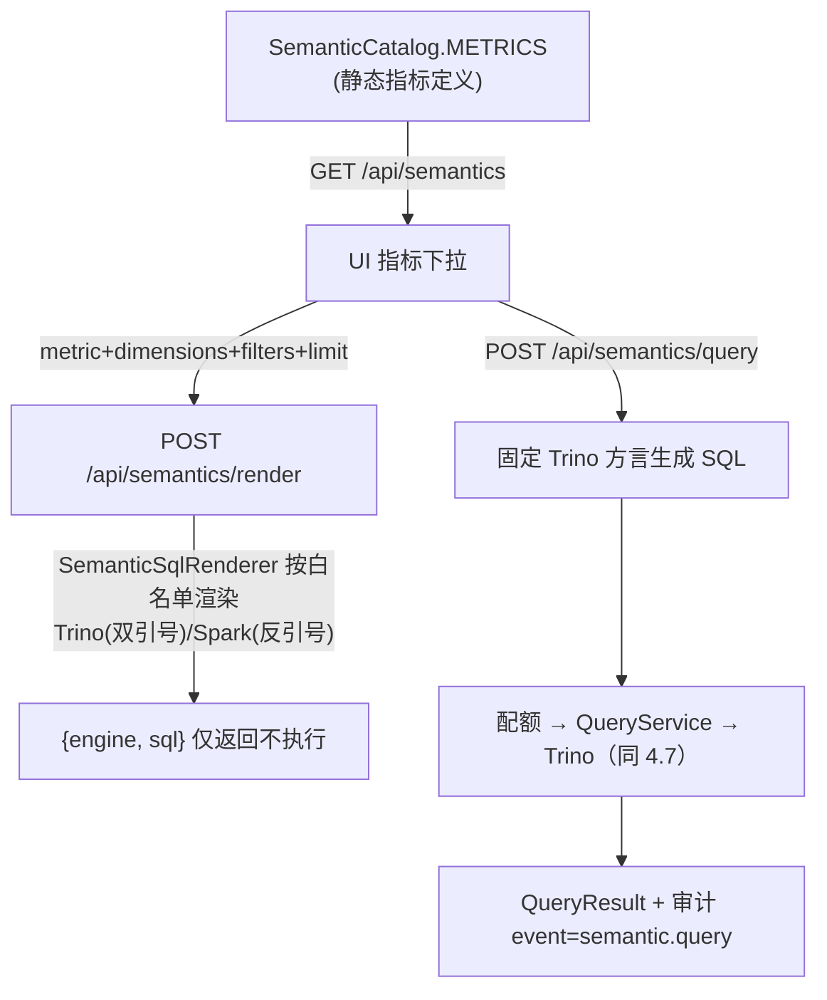

- **render 不执行 SQL、不查 Trino、不占配额、不审计**，只给调用方拿多引擎方言的 SQL；两方言口径一致、仅标识符引号不同。〔FACT｜controller/SemanticController.java:90-95〕〔FACT｜common/semantic/SemanticSqlRenderer.java:41-56〕
- **query 固定 Trino 方言**（即使传 engine=spark），复用查询链路，审计事件名 `semantic.query` 并附带 metric。〔FACT｜controller/SemanticController.java:97-120〕
- 渲染器对表名/维度/过滤字段做白名单校验，字面量按类型渲染（`dt` 必须是 `yyyy-MM-dd`，数值直出，其余单引号转义），不成为新的注入入口。〔FACT｜common/semantic/SemanticSqlRenderer.java:58-141〕

> 口径已统一：`refund_rate` 语义层口径为 `SUM(refund_amount) / NULLIF(SUM(gmv), 0)`（比例、防除零）；ad-hoc 脚本 `01_daily_revenue.sql` 的 `refund_rate` 已对齐同一表达式（保留 4 位小数）。两处通过注释**双向回指**防漂移。另 `06_refund_by_category.sql` 的 `refund_rate_pct` 是「退款订单数占比」（扫 silver 明细），属不同业务概念。〔FACT｜common/semantic/SemanticCatalog.java:23-24〕〔FACT｜sql/adhoc/01_daily_revenue.sql:4,11〕

### 4.9 SSE 流式查询流

**从哪儿来**：`POST /api/query/stream`（用 POST 而非 GET，避免 SQL 进 URL 被访问日志记录且受长度限制）。〔FACT｜controller/QueryController.java:104-140〕

**怎么流转**：与 JSON 接口共用配额、SqlGuard、Trino 执行；`streamQuery()` 用 `Flux.create` 边读 ResultSet 边发，每 200 行发一批。事件顺序：

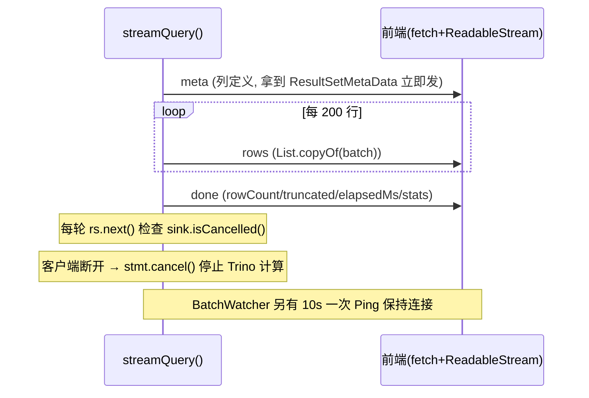

异常时经 `onErrorResume` 翻成 `error` 事件（响应头已是 200 无法改状态码），由 `ErrorMapper` 统一映射。〔FACT｜query/service/QueryService.java:54,196-258〕〔FACT｜controller/QueryController.java:123-139〕

**到哪儿去**：前端 `QueryView` 按 `meta→rows→done→error` 增量渲染 `ResultTable`；离开页面 `AbortController.abort()` 取消流。〔FACT｜lake-ui/src/views/QueryView.vue:67-72,93-160,165〕

### 4.10 批作业编排流：提交 → 执行 → 终态（最重要）

这是系统最复杂的数据流，核心是**三条运行记录通道分离 + 一条治理旁路**。

#### 三条数据通道

| 通道 | 存储 | 写入方 | 生命周期 |
|---|---|---|---|
| ① 服务侧运行态 | Postgres `lake_batch.batch_runs`（非湖表） | lake-service `JdbcRunStateStore` | 多实例共享，重启不丢 |
| ② 共享日志尾部 | Postgres `lake_batch.batch_log_lines` | 执行器 → `JdbcLogStore` | 每 run 留尾 2000 行，7 天 |
| ③ 湖表历史归档 | Iceberg `ops.batch_runs`（经 Trino 读） | **spark-batch** `RunRecordWriter` | 长期、跨进程的权威归档 |

〔FACT｜support/StateDbTables.java:11-20〕〔FACT｜batch/store/JdbcLogStore.java:21-31〕〔FACT｜batch/store/RunStateStore.java:10-13〕

**治理旁路**：`QualityJob` / `RetentionJob` / `LineageWriter` 分别写 `ops.dq_results` / `ops.retention_audit` / `ops.lineage_runs`，`all` 链路已串入 quality。〔FACT｜common/catalog/LakeTables.java:52-56〕〔FACT｜spark-batch/BatchApp.java:124-139〕

#### 主链路（提交到终态）

```mermaid
sequenceDiagram
    participant UI as JobsView
    participant Ctl as BatchController
    participant Svc as BatchJobService
    participant PG as lake_batch.batch_runs
    participant D as JobDispatcher
    participant E as LocalProcessJobExecutor
    participant BP as BatchApp 子进程
    participant LK as Iceberg ops.*

    UI->>Ctl: POST /api/batch/{job} (+Idempotency-Key)
    Ctl->>Svc: submit(job, key)（offload blocking）
    Svc->>Svc: 白名单(allowed-jobs)→幂等→RunIds.generate→模板拼命令→建日志目录
    Svc->>PG: insert(QUEUED, owner=本实例)
    Svc-->>UI: 202 + BatchRun
    UI->>UI: follow(id) 建 SSE（含 10s Ping）
    loop 每 1s
        D->>PG: 行锁内 claimNextIfSlotAvailable(owner,max) → QUEUED→RUNNING
        D->>E: executor.start(注入 BATCH_RUN_ID/BATCH_RUN_LOG)
        E->>BP: java -cp 启动预构建的 BatchApp
        BP->>BP: RunIds.resolve(BATCH_RUN_ID) → 跑 job（all 含 quality）
        BP->>LK: finally 写终态 + 血缘（失败不改退出码）
        E->>PG: 每500ms flush 日志; 退出→completed
        E->>PG: state.finish(终态) + 审计 + 缓存失效
    end
    Note over UI: BatchWatcher 推 status/log/end（+Ping）SSE
```

**关键数据节点**：
1. **提交**：`BatchJobService.submit` 做白名单校验（`lake.batch.allowed-jobs`，默认 `LakeJobs.CHOICES`）、快路径幂等命中查询、`RunIds.generate()` 生成 runId、命令模板 `bin/dev-batch.sh --job {job}` 拼命令、建日志目录；带幂等键时由 `insertWithIdempotency` 在事务内抢占键并写入 QUEUED，并发重复提交只有一个胜出。〔FACT｜batch/service/BatchJobService.java:139-199〕
2. **认领**：Dispatcher 每 1s 扫描，`claimNextIfSlotAvailable` 在同一把数据库行锁（`DbLocks.DISPATCH`）里做「RUNNING 数 < max」检查与条件 UPDATE 认领，多实例既不重复执行也不越过 `max-concurrent-jobs`（默认 2）。〔FACT｜batch/service/JobDispatcher.java:47-56,61-87〕〔FACT｜batch/store/JdbcRunStateStore.java:254-268〕
3. **执行**：本地执行器把 stdout/stderr 重定向到 `logs/batch/{id}.log`（CLI 直跑用 `BATCH_RUN_LOG` + `tee`，同一 runId 的日志路径回填到 `ops.batch_runs.log_file`），注入 `BATCH_RUN_ID` 与 `BATCH_RUN_LOG`；虚拟线程循环 `waitFor(500ms)` + 每轮 flush 日志到 Postgres，退出码 0→SUCCEEDED/非 0→FAILED/超时→TIMEOUT。〔FACT｜batch/service/LocalProcessJobExecutor.java:35-95〕〔FACT｜spark-batch/RunRecordWriter.java:91-93〕
4. **终态回流**：`JobCompletionService.completed()` 写终态到运行态库、令湖表历史缓存失效、打指标与审计。〔FACT｜batch/service/JobCompletionService.java:25-42〕
5. **runId 对齐**：服务端生成 runId（12 位十六进制随机后缀，防同分钟撞号）→ 注入子进程 → `RunIds.resolve` 取出 → 既写 bronze 每行、又写 `ops.batch_runs` 与各治理 ops 表，二者指向同一批次。〔FACT｜common/batch/RunIds.java:14-22,37-38,40-56〕〔FACT｜spark-batch/BatchApp.java:83-116〕

**K8s 执行方式**：`executor=kubernetes` 时改为通过 K8s Job API 创建 Job（JWT 从 in-cluster ServiceAccount 读取），注入同样的环境变量；终态不再定时轮询，而是用 `watch=true` 长连接把 Job status 变化推成 NDJSON 事件，虚拟线程收到 `succeeded`/`failed` 立即回调，服务端按 `timeoutSeconds` 关流后带 `resourceVersion` 续接、410 Gone 则重新建连。〔FACT｜batch/service/KubernetesJobExecutor.java:70-204,449-479〕

**K8s 日志搬运**：Job 的 Pod 模板带 `lake-job=<jobName>` 标签，日志线程 watch 该标签的 PodList，拿到 Pod 名且 `status.phase` 离开 `Pending` 后用 `GET .../pods/{pod}/log?follow=true` 持续读 stdout/stderr，按 100 行/1 秒批量写进同一个 `LogStore`（`lake_batch.batch_log_lines`）；日志接口偶发 4xx（容器刚起的竞态）才短退避重试。终态到达后先等日志读到 EOF（最长 2 秒），再置停止位并关掉 watch / follow 长连接，避免虚拟线程挂在长连接上。这样 tail / SSE 在 K8s 模式下也从状态库读，和本地模式一致。〔FACT｜batch/service/KubernetesJobExecutor.java:206-291,348-421,482-519〕

**外部调度触发**：调度器不直接跑 Spark，而是调 `bin/scheduled-batch.sh` → `POST /api/batch/{job}`。幂等键取 `lake-<job>-<逻辑日期>`（Airflow 用 `{{ ds }}`、DS 用 `${bizdate}`），同一逻辑日重跑返回同一条运行记录；脚本默认等终态，退出码 0/1/2 直接当调度任务状态，失败时回显日志尾部。`ingest → transform` 每日串跑，`maintain` 单独定时。详见 §4.15 与 `scheduler/README.md`。〔FACT｜bin/scheduled-batch.sh:73-136〕

### 4.11 运行历史读取与僵死恢复流

**读历史**：`GET /api/batch/runs` → `BatchJobService.list()` = 运行态库 `state.recent()` ∪ 湖表 `BatchHistoryService.recent()`（经 Trino 读 `ops.batch_runs`），按 id 合并、终态优先、按 started_ms 倒序。湖表读不到时降级为提示（`RunsView.history`），不把接口打成 500。〔FACT｜batch/service/BatchJobService.java:201-224〕〔FACT｜batch/model/RunsView.java:5-25〕

**僵死恢复**（每 60s 对账）：心跳由 `liveRuns.snapshot()` 中的活 run 每 15s 续写；对账只挑 `heartbeat_ms < now-120s` 的 RUNNING 行——

```
staleRunning(heartbeat_ms < now - 120s) → 查湖表 ops.batch_runs
   ├─ 拿到终态 → state.finish(采纳湖表终态)
   └─ 无终态 → state.markLost("实例失联", exit_code=1)
顺便 purge 过期日志(7d) 与过期审计原文
```

〔FACT｜batch/service/BatchJobService.java:75-125〕〔FACT｜batch/store/JdbcRunStateStore.java:73,201-205〕

### 4.12 审计与可观测流

**身份与登录**：浏览器提交 `POST /api/auth/login`（公开端点，不弹原生 Basic 框）→ `auth.js` 把凭据存内存并给每个请求（含 SSE）加 Basic 头 → `GET /api/auth/session` 回显 mode/user/roles；静态账号 viewer/operator/**analyst**/auditor，external 模式由网关注入身份头。〔FACT｜controller/AuthController.java:50,89〕〔FACT｜lake-service/src/main/resources/application.yml:57-76〕

- **审计三重出口**：`AuditService.record()` 生成 UUID eventId → 写 `logs/audit.log`（90 天滚动，独立 logger）+ 内存环形缓冲（最近 200 条，`GET /api/audit`）+ 返回 eventId 供保险箱关联。SQL 只写 SHA-256 前 8 字节（16 个十六进制字符）指纹，不写原文/口令。〔FACT｜observability/service/AuditService.java:29-63〕〔FACT｜observability/store/AuditBuffer.java:16〕
- **原文保险箱**（可选，默认关闭）：开启后 SQL 经 `SqlRedactor` 启发式脱敏 → AES-GCM 加密（`eventId` 作 AAD）→ Postgres `lake_audit.query_text`，同时记录 `key_id`；密钥按 `key_id` 组成密钥环，轮换后旧原文仍可读。缺密钥/解密失败会抛错并计 `lake.audit.vault.decrypt.error`，不再伪装成 404。AUDITOR 可 `GET /api/audit/sql/{eventId}` 解密调阅、`POST .../hold` 置法律保全跳过 TTL，每次调阅再写一条 `audit.text_access`。〔FACT｜observability/store/AuditTextStore.java:57-58,100-164,210-221〕〔FACT｜controller/AuditController.java:51-92〕
- **指标**：Micrometer 埋点同时经 `/actuator/metrics`（人看）与 `/actuator/prometheus`（抓取，需 BATCH 角色）暴露；内置 `micrometer-registry-prometheus`，名字含 `lake.query.*` / `lake.batch.*` / `lake.auth.denied` / `lake.iceberg.*` / `lake.governance.*`。SLI/SLO 与 **8 条告警规则**（5 条核心 + 新鲜度超时 + ERROR 质量失败 + WARN 质量失败）见 `docs/OBSERVABILITY.md` 与 `infra/prometheus/rules/lake-slo.yml`。〔FACT｜observability/service/LakeMetrics.java:24-62〕〔FACT｜infra/prometheus/rules/lake-slo.yml:6,18,29,41,51,62,74,84〕
- **湖表指标采集**：`IcebergTableMetrics` 每 60s 经 Trino 查 `iceberg.lake."{table}$files"` / `$snapshots`，写 5 个带 `table` 标签的 gauge：`files` / `avg_file_size_bytes` / `total_size_bytes` / `snapshots` / `last_committed_epoch_ms`；Trino 没起或表不存在时保留上次值。〔FACT｜observability/service/IcebergTableMetrics.java:35-139,193-197〕
- **治理指标**：`GovernanceMetrics` 每 60s 从 `IcebergTableMetrics.snapshot()` 的 `committed_at` 换算新鲜度小时数并对 `GovernanceCatalog` 的 SLA 打 gauge（`lake.governance.freshness.hours` / `freshness.sla.hours`），从 `DqResultService.recentStrict()` 取最新质量结果打 `lake.governance.dq.failed`；读失败抛错、不清零，避免误报恢复。〔FACT｜observability/service/GovernanceMetrics.java:38-40,97-147〕
- **监控栈**：可选 `monitoring` profile 起 Prometheus（host 网络，抓 `127.0.0.1:8088`，basic_auth=operator）与 Grafana（数据源/面板自动装载，9 个 panel）。〔FACT｜infra/docker-compose.yml:164-212〕〔FACT｜infra/prometheus/prometheus.yml:1-25〕

### 4.13 前端控制台流（lake-ui）

- **查询台**：SQL 来源优先级 = URL `?sql=` > `store.draftSql`（表浏览跳转）> localStorage > 空；执行走 `POST /api/query/stream` + SSE；离开页面 `AbortController.abort()` 取消流。〔FACT｜lake-ui/src/views/QueryView.vue:67-72,93-160,165〕
- **表浏览**：`/api/tables` 拿清单 → 合并 `/api/governance/assets` 的敏感级别/新鲜度徽标（失败仅隐藏徽标不挡采样）→ 点表 `/api/tables/{t}/sample` 按角色读脱敏视图；「在查询台打开」写 `store.draftSql` 后跳转。〔FACT｜lake-ui/src/views/TablesView.vue:31-35,61-70〕
- **批作业**：作业卡片来自 `/api/config` 下发的 `LakeJobs.visible(allowedJobs)`；提交 POST、6s 轮询列表、SSE 跟随日志（1/2/4/5s 退避重连），后台标签页断 SSE。〔FACT｜lake-ui/src/views/JobsView.vue:39-41,112-163,238〕
- **指标页 / 配置页**：分别消费 `/api/semantics*` 与 `/api/config`。〔FACT｜lake-ui/src/views/SemanticView.vue:36-81〕〔FACT｜lake-ui/src/views/ConfigView.vue:10-71〕
- **审计页**：`GET /api/audit` 按时间倒序展示环形缓冲事件；AUDITOR 可点进原文调阅与法律保全。〔FACT｜lake-ui/src/views/AuditView.vue〕〔FACT｜lake-service/src/main/resources/static/ui/〕
- **治理页**：消费 `/api/governance/{assets,dq,lineage,retention}` 四个端点，展示资产/质量/血缘/保留卡片。〔FACT｜lake-ui/src/views/GovernanceView.vue〕
- **登录页**：`App.vue` 在 `auth.status !== 'authenticated'` 时只渲染 `LoginView`，提交 `/api/auth/login` 后凭据进内存。〔FACT｜lake-ui/src/App.vue:19-20〕

### 4.14 即席查询流（lake-adhoc：官方 trino-jdbc + SqlParams）

```
bin/trino-query.sh --sql-file <脚本> [--params k=v] [--explain] [--print-only]
   → shell 把参数原样交给 java（只把 --sql=... 拆成 --sql value），不再落临时文件
   → java -cp 直起（lake-adhoc/target/classes + platform-common/target/classes + 预生成 classpath.txt）
        com.demo.lake.adhoc.TrinoQuery：
        ① PlatformConfig.load() 拿 trinoJdbcUrl()/trinoUser()/trinoSource()
           （--url > --server > PlatformConfig 的覆盖优先级）
        ② SqlParams.prepare()：SqlScript.split() 精确切句（跳过注释/字符串里的分号）
           · ${key} → value 替换；仍有残留占位符 = 缺参，整条语句跳过
           · --explain 时给语句加 EXPLAIN 前缀
        ③ TrinoClient.connect()：官方 trino-jdbc，timezone=UTC + setReadOnly(true)
        ④ 逐条 stmt.executeQuery() → ResultSet 转列/行（--limit 截断）→ TableFormatter 带边框表格
           · QueryStats 总是采集（queryId/splits/rows/peakMem），--stats 才打印
   → 输出：+----+ 边框表格（CJK 宽字符对齐由 TableFormatter 处理）
```

〔FACT｜bin/trino-query.sh:1-47〕〔FACT｜bin/build.sh:90-100〕〔FACT｜lake-adhoc/TrinoQuery.java:28-124〕〔FACT｜lake-adhoc/TrinoClient.java:32-94〕

**结果输出**：自研的 `TableFormatter`（纯显示层，约 110 行）按 code point 计算显示宽度，组合符号占 0 列、CJK/全角/emoji 占 2 列，中文表头不错位；`Timestamp` 输出 ISO-8601 绝对时刻在 `TrinoClient` 完成，不受 JVM 时区影响。这是在官方 JDBC 驱动之上唯一保留的自研显示逻辑。〔FACT｜lake-adhoc/TableFormatter.java:43-85〕〔FACT｜lake-adhoc/TrinoClient.java:103-105〕

**脱敏视图 CLI**：`bin/init-views.sh` → `com.demo.lake.adhoc.TrinoViews` 读 `LakeViews` 外置模板，在 Trino 侧 `CREATE OR REPLACE VIEW` 创建 bronze/silver 各两张视图（masked/restricted），与服务启动时的 `LakeViewDdl` 共用同一批 SQL，便于纯 Trino 环境初始化。〔FACT｜lake-adhoc/TrinoViews.java:25-88〕〔FACT｜observability/service/LakeViewDdl.java:23-47〕

另有 `VerifySqlJob`（批处理侧）：读 ad-hoc 脚本 → 跳过 `@trino-only` 语句 → `TrinoDialect.toSpark()` 做最小方言适配（`date_add`→`date_sub`、`INTERVAL '1' DAY`→`INTERVAL 1 DAYS`）→ `spark.sql` 校验，不落表。〔FACT｜spark-batch/job/VerifySqlJob.java:41-65〕〔FACT｜common/sql/TrinoDialect.java:29-61〕

### 4.15 外部调度触发流（Airflow / DolphinScheduler）

```
调度器（Airflow DAG / DS Shell 任务 / cron）
  → bin/scheduled-batch.sh --job <job> --date <逻辑日期> [--wait|--no-wait] [--poll N] [--dry-run]
       ① 生成幂等键 lake-<job>-<YYYY-MM-DD>（日期来自 {{ ds }} / ${bizdate}）
       ② POST /api/batch/{job} + Idempotency-Key + Basic（或网关头）
       ③ 202 + runId；同一键重跑返回同一 runId（服务日志「幂等命中」）
       ④ 轮询 GET /api/batch/runs/{id}?tail=20 直到 SUCCEEDED / FAILED / TIMEOUT
   → 退出码 0/1/2 = 调度任务状态；失败时打印 message + 日志尾部
```

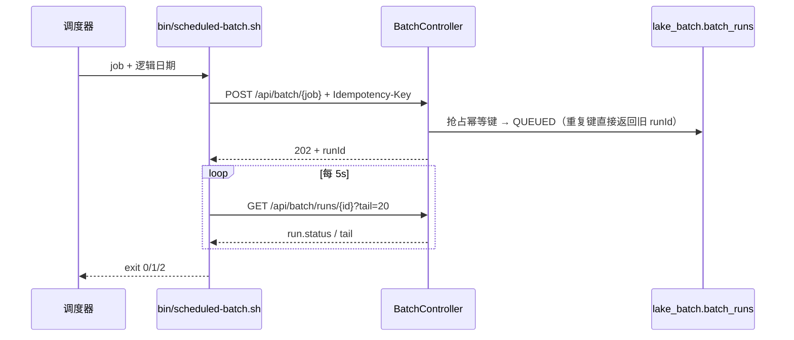

**关键约束**：① 调度器只拿「提交 + 终态」两个语义，不知道 Spark 命令，也不知道 Postgres 在哪；② 幂等键是 `(job, 逻辑日期)`，重跑/重试不会产生第二条运行记录；③ `maintain` 不在每日链里，单独定时，避免和写入抢资源。〔FACT｜bin/scheduled-batch.sh:73-136〕〔FACT｜scheduler/airflow/dag_lakehouse_daily.py:20-47〕〔FACT｜scheduler/airflow/dag_lakehouse_maintain.py:12-33〕

### 4.16 湖表指标采集流（$files / $snapshots / 治理）

```
Trino metadata 表（iceberg.lake."{table}$files" / $snapshots）
   ← IcebergTableMetrics 虚拟线程每 60s 查一次（经 trinoDataSource，只读）
   → Micrometer gauge：lake.iceberg.files / avg_file_size_bytes / total_size_bytes / snapshots /
                       last_committed_epoch_ms（tag=table）
   → /actuator/prometheus → Prometheus 抓取 → Grafana 面板
   → GovernanceMetrics 取 committed_at 换算新鲜度 → lake.governance.freshness.* → 告警
```

**为什么用 Trino 而不是 Iceberg 客户端**：服务侧已经有只读 Trino 连接池，元数据表查询只是两条 SQL，不需要再引一个 Iceberg runtime 依赖（版本与 Spark 绑死，容易冲突）。表名做白名单校验（`[A-Za-z0-9_]+`），`$` 元数据表名整体加双引号；查询失败只 debug 记日志并保留上次 gauge 值。〔FACT｜observability/service/IcebergTableMetrics.java:37-139〕〔FACT｜lake-service/src/main/resources/application.yml:78-87〕

---

## 5. 数据模型概览

### 5.1 核心实体关系图（ER）

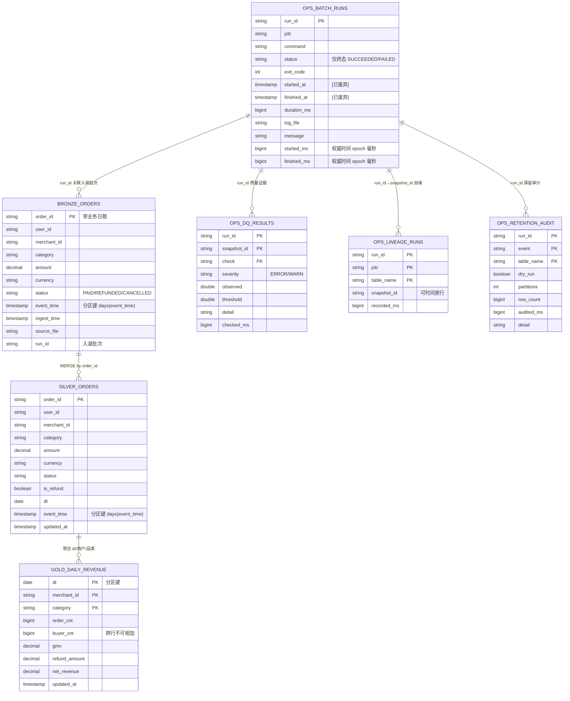

列清单来自 `platform-common/src/main/resources/sql/ddl/{10,20,30,40,50,60,70}_*.sql`。

### 5.2 运行态库表（Postgres，服务私有）

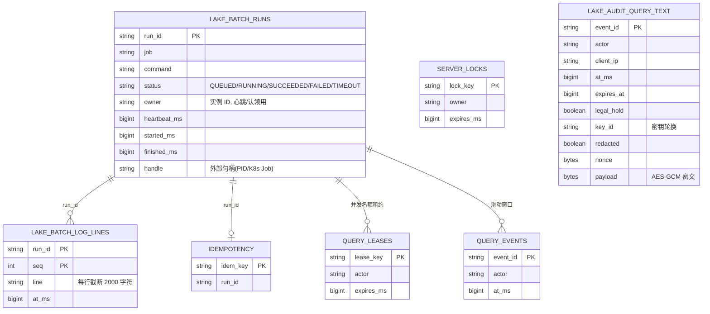

〔FACT｜lake-service/src/main/resources/sql/state/20_query_leases.sql〕〔FACT｜lake-service/src/main/resources/sql/state/21_query_events.sql〕〔FACT｜lake-service/src/main/resources/sql/state/30_batch_runs.sql〕〔FACT｜lake-service/src/main/resources/sql/state/33_idempotency.sql〕〔FACT｜lake-service/src/main/resources/sql/state/50_query_text.sql:6-12〕〔FACT｜support/StateDbTables.java:11-20〕〔FACT｜support/StateDbDdl.java:22-39〕

> 幂等键在独立表 `lake_batch.idempotency`，不在 `batch_runs` 里；`server_locks` / `query_leases` / `query_events` 与 `31/32/33` 三个迁移脚本共同构成状态库迁移链。

### 5.3 关键字段说明

| 字段 | 所在 | 说明 |
|---|---|---|
| `run_id` | bronze / ops.batch_runs / 各治理 ops 表 / lake_batch.batch_runs | 跨模块贯穿的批次标识，服务端与 spark-batch 共用 `RunIds.generate()`；12 位十六进制随机后缀防同分钟批量撞号。〔FACT｜common/batch/RunIds.java:14-22,37-38,52-56〕 |
| `started_ms`/`finished_ms` | ops.batch_runs | **权威时间**，epoch 毫秒，绝对时刻不受时区影响；旧 `started_at/finished_at` 墙钟列已废弃。〔FACT｜platform-common/src/main/resources/sql/ddl/40_ops_batch_runs.sql:4,12-13,17-18〕 |
| `buyer_cnt` | gold | （商户,品类）粒度去重用户数，**跨行相加是"人次"不是全站买家数**。〔FACT｜platform-common/src/main/resources/sql/ddl/30_gold_daily_revenue.sql:7〕 |
| `event_time` | bronze/silver | 隐藏分区 `days(event_time)` 的来源，迟到数据进正确历史分区。〔FACT｜platform-common/src/main/resources/sql/ddl/10_bronze_orders.sql:12,18〕〔FACT｜platform-common/src/main/resources/sql/ddl/20_silver_orders.sql:16〕 |
| `snapshot_id` | ops.lineage_runs / ops.dq_results | 取 Iceberg 元数据里 `committed_at` 最新的快照；Iceberg 1.11 的 snapshot_id 是随机 UUID，不能用 `max()`。〔FACT｜platform-common/src/main/resources/sql/ddl/60_ops_lineage_runs.sql:5-6〕 |
| `log_file` | ops.batch_runs | CLI 直跑时由 `BATCH_RUN_LOG` 环境变量回填，重启后仍可 tail。〔FACT｜spark-batch/RunRecordWriter.java:91-93〕 |

---

## 6. 关键设计决策（ADR 风格）

### ADR-1：行级写一律 CoW（copy-on-write），不用 MoR
- **背景**：Trino（读侧）处理 MoR 的 delete file 跨引擎易踩坑，版本不齐会静默出错。〔FACT｜README.md:439-445〕
- **采用**：CoW，`format-version=2`，`write.merge/update/delete.mode=copy-on-write`。
- **后果**：写放大；如需 MoR 可打开 `platform.write-mode=merge-on-read`（两端版本都验证过后）。

### ADR-2：ODS/DWD 用 `days(event_time)` 隐藏分区，不用入湖日期
- **背景**：上游按 `dt` 分目录，但业务关心事件时间；迟到数据若按入湖日期分区会错位。
- **采用**：按事件时间路由分区，迟到数据进正确历史分区，SQL 不显式指定分区。〔FACT｜README.md:447-449〕
- **后果**：分区路由由 Iceberg 自动完成。

### ADR-3：去重用 `MERGE` + `row_number()`，不做全量覆盖
- **背景**：3% 重复单、10% 迟到数据需要修正，全量覆盖代价太大。
- **采用**：按 order_id 取最新事件，`WHEN MATCHED AND s.event_time > t.event_time` 只更新变化行，只扫近 N 天分区。〔FACT｜README.md:451-453〕
- **后果**：修正代价被限制在变化行与近 N 天分区。

### ADR-4：时间是权威 epoch 毫秒，不靠时区约定
- **背景**：墙钟时间列在不同 JVM/会话时区下会让历史列表偏移（如 8 小时）。〔FACT｜README.md:182-187〕
- **采用**：`ops.batch_runs.started_ms/finished_ms` 直接存绝对时刻；配合 `spark.sql.session.timeZone=UTC`、JDBC `timezone=UTC`。〔FACT｜common/config/PlatformConfig.java:183〕
- **后果**：编进 schema 的绝对时刻与时区无关，历史稳定。

### ADR-5：批作业用子进程，不在 Web 容器里养 SparkSession
- **背景**：SparkSession 塞进 Spring 应用会让内存/线程/崩溃隔离变差。〔FACT｜README.md:215-216〕
- **采用**：Web 层只提交命令、`local` 起子进程（默认）或 `kubernetes` 提 Job；换 yarn 只改 `command-template`。
- **后果**：多一层进程边界，但隔离性、可替换性好。

### ADR-6：作业走调度器，提交只落 QUEUED
- **背景**：请求线程直接 fork 会无限制并发、无法排队。〔FACT｜README.md:217-222〕
- **采用**：提交只落一条 QUEUED；Dispatcher 按提交顺序在行锁内原子认领，受全局并发上限约束；支持 Idempotency-Key 去重。
- **后果**：任务有排队语义；认领依赖数据库的原子 UPDATE。

### ADR-7：服务无状态，RUNNING 写 Postgres，历史归档写湖表
- **背景**：RUNNING 放内存会导致服务重启/多实例看不到同一份列表。〔FACT｜README.md:223-231〕
- **采用**：运行态写 `lake_batch.batch_runs`（只给 `liveRuns` 快照里仍活着的 run 每 15s 续心跳）；湖表 `ops.batch_runs` 作跨引擎长期归档；`heartbeat_ms < now-120s` 的僵死作业先尝试从湖表终态恢复，否则落「实例失联」。
- **后果**：引入 Postgres 依赖，但对账机制保证最终一致。

### ADR-8：长任务用 SSE，不用轮询
- **背景**：前端定时打接口浪费且延迟高。〔FACT｜README.md:237-238〕
- **采用**：查询结果与作业跟踪各用一条长连接推到底（作业流另有 10s Ping）；客户端断开时 `stmt.cancel()` / 停日志游标。
- **后果**：服务端需维护流生命周期，但体验与资源更优。

### ADR-9：有语义层，口径只维护一份
- **背景**：同一指标在多处写不同 SQL 会导致口径不一致（退款率曾在语义层与 ad-hoc 脚本出现两种表达式，现已统一）。〔FACT｜README.md:188-191〕
- **采用**：`SemanticCatalog` 集中定义口径，调用方只能选指标/白名单维度/过滤，服务端生成 SQL 并执行；`SemanticSqlRenderer` 支持 Trino/Spark 两方言下推。
- **后果**：新增指标需改 common 代码重新构建（编译期硬编码）。

### ADR-10：SQL 默认只读 + 配额 + 诊断式错误
- **背景**：对外暴露「能跑任意 SQL」的接口太危险；慢查询会拖垮服务。〔FACT｜README.md:181-183,203-214〕
- **采用**：`SqlGuard` 白名单（含 `EXPLAIN ANALYZE` 内层递归校验、quote-aware 注释剥离，`allowWrites` 可显式放开）、落 Postgres 的全局并发 + 单账号滑动窗口（超限 429，多实例共享额度）、Trino 不可用返回 503 并提示「先起 Trino」、`initializationFailTimeout=-1` 让服务照常启动。
- **后果**：demo 级防护，生产需网关/IdP 接管认证。

### ADR-11：即席查询用官方 trino-jdbc 薄封装，不依赖外部 CLI
- **背景**：原自研 CLI 协议层重复造轮子；官方 CLI 需本地二进制/容器访问，远端只开 JDBC 端口时失效，非 TTY 输出还要脏适配。
- **采用**：`SqlParams`（platform-common，复用 `SqlScript.split()` 做 `${var}` 替换 + 缺参跳过）+ `TrinoClient`（官方 trino-jdbc）+ `TableFormatter`（纯显示层）+ `TrinoViews`（视图 CLI）。`bin/trino-query.sh` 只做 `java -cp` 参数转发，classpath 由 `bin/build.sh` 预生成。〔FACT｜common/cli/SqlParams.java:12-19〕〔FACT｜lake-adhoc/TrinoQuery.java:17-23〕
- **后果**：客户端截断/中文对齐/`--stats` 全部保留；唯一自研部分是显示层，不涉及 Trino 协议实现。

### ADR-12：外部调度经服务 API 触发，不直连 Spark
- **背景**：直接调 `spark-submit` 会绕过白名单、幂等、配额与运行态。
- **采用**：`bin/scheduled-batch.sh` 以 `(job, 逻辑日期)` 生成幂等键调 REST；调度器只关心终态退出码。〔FACT｜bin/scheduled-batch.sh:73-136〕
- **后果**：调度器与执行引擎解耦；同一逻辑日重跑不会重复执行。

### ADR-13：生产鉴权用网关外部模式，fail closed
- **背景**：demo 静态 Basic 账号不能上生产；服务直接暴露公网时身份头可伪造。
- **采用**：`lake.security.mode=external`，只信任带共享密钥的网关注入头；缺密钥/错密钥/缺身份头一律拒绝；Trino LDAP + 视图分级授权，HMS 用 Ranger 模板。〔FACT｜infra/trino/auth/rules.json:1-53〕
- **后果**：鉴权边界移到网关，共享密钥与角色映射要三处对齐。详见 `docs/SECURITY.md`。

### ADR-14：湖表指标走 Trino 元数据表，不引 Iceberg 客户端
- **背景**：服务已持 Trino 只读连接池；再引 Iceberg runtime 会与 Spark 版本绑死并增加 fat jar 体积。
- **采用**：`IcebergTableMetrics` 用两条 SQL 查 `$files` / `$snapshots`，写 5 个 Micrometer gauge；`GovernanceMetrics` 复用其 `committed_at` 算新鲜度。〔FACT｜observability/service/IcebergTableMetrics.java:35-197〕
- **后果**：指标有最多一个采集周期的延迟；查询失败不影响服务，面板接受「上次值」。

### ADR-15：存储清理分三层，不用 bucket 过期删当前数据
- **背景**：旧元数据、崩溃遗留分片、过期快照孤儿文件，单靠任何一层都清不干净。
- **采用**：表属性（`delete-after-commit` + `previous-versions-max=20`）管元数据；bucket lifecycle 只清未完成分片/非当前版本/staging；`remove_orphan_files` 做引用感知的数据文件清理。〔FACT｜infra/storage/lifecycle.json:1-22〕
- **后果**：绝不能在 `warehouse/` 前缀设当前对象 `Expiration`，否则会删掉 Iceberg 仍引用的文件。详见 `docs/STORAGE.md`。

### ADR-16：血缘写在 SQL 注释 + 快照 ID 落 ops 表
- **背景**：设计级血缘（表/列依赖）与运行级血缘（具体数据版本）需要同时可查，但不应改动业务表结构。
- **采用**：`@lineage table/column` 注释随 SQL 模板外置并被 `LineageParser` 解析；运行期 `LineageWriter` 把 `run_id → table → snapshot_id` 写 `ops.lineage_runs`；快照 ID 按 `committed_at` 取最新（Iceberg 1.11 的 ID 是随机 UUID，不能用 `max`）。〔FACT｜spark-batch/LineageWriter.java:28-67〕
- **后果**：血缘采集是 best-effort，失败不影响作业结果；读侧合并两侧视图。

### ADR-17：保留治理默认 dry-run，删除前后都审计
- **背景**：按保留天数删分区是不可逆操作，误删代价高；同时需要可证明「谁在什么时候评估过哪些分区」。
- **采用**：`RetentionJob` 默认只统计，`--execute` 才删除；每张表前后各写一条 `ops.retention_audit`，审计写失败让作业 FAILED。〔FACT｜spark-batch/job/RetentionJob.java:42-97〕
- **后果**：运维需显式加 `--execute`；审计表成为保留策略执行的证据链。

---

## 7. 跨切面关注点

### 7.1 认证与授权

两种模式，由 `lake.security.mode` 选择：

- **local（demo 默认）**：HTTP Basic + 静态账号——viewer(QUERY)、operator(QUERY+BATCH)、**analyst(QUERY+ANALYST)**、auditor(AUDITOR)。〔FACT｜lake-service/src/main/resources/application.yml:57-76〕
- **external（生产）**：网关完成认证后注入 `X-Forwarded-User` / `X-Forwarded-Roles` + `X-Auth-Shared-Secret`；缺密钥/错密钥/缺身份头一律 401（fail closed），静态账号完全不生效。网关必须剥离客户端自带的这些头。
- **路径角色映射**：`/api/query*|tables*|semantics*|governance*|config`→QUERY，`/api/tables/*/sample`→QUERY|AUDITOR，`/api/batch/**` GET→QUERY/非 GET→BATCH，`/api/audit/sql*`→AUDITOR，`/api/audit*`→QUERY|AUDITOR，`actuator/**`→BATCH。公开路径含 `/`、`/ui/**`、`/actuator/health|info`、`/api/auth/session|login`、`/index.html`、`/favicon.ico`、`/error`、`/v3/api-docs`、`/swagger-ui.html`、`/webjars/`。〔FACT｜security/ApiAuthWebFilter.java:54-171,123-135,146-170〕
- **引擎侧另行授权**：Trino LDAP + `rules.json` 做 catalog/schema/table 三级控制并对 masked/restricted 视图分别 `GRANT SELECT`（viewer / analyst / masked_reader）；HMS 用 Ranger 插件模板；三处角色要对齐。详见 `docs/SECURITY.md`。〔FACT｜infra/trino/auth/rules.json:1-53〕

### 7.2 错误处理策略

统一 `ErrorMapper` 映射：空/多语句/非只读→400、语义越界→400、Trino 拒绝→400、连不上 Trino→503、配额超限→429、404/白名单取自身状态码，兜底 500；映射会沿 cause 链查找，非法 JSON 也走 400。JSON 接口由 `ApiExceptionHandler` 返回 `ApiError(status,error,message,hint)`；SSE 流开始后无法改状态码，改为发 `error` 事件。〔FACT｜exception/ErrorMapper.java:30-77〕〔FACT｜exception/ApiExceptionHandler.java:14-28〕

### 7.3 日志与可观测性

三条独立日志出口：普通日志 `logs/lake-service.*.log.gz`、审计 `logs/audit.log`（独立 logger，90 天）、批作业日志 `logs/batch/{id}.log`（同时实时搬进 Postgres `lake_batch.batch_log_lines`，本地/K8s 执行器共用）。〔FACT｜logback-spring.xml:16-19,31-46〕

指标侧：Micrometer 同时暴露 `/actuator/metrics` 与 `/actuator/prometheus`（后者需 BATCH 角色）；可选 `monitoring` profile 起 Prometheus + Grafana（9 个 panel），**8 条告警规则**与 SLO 一一对应；`IcebergTableMetrics` 每 60s 补 5 个湖表 gauge，`GovernanceMetrics` 补新鲜度/质量 gauge 且读失败不清零。访问日志在 `doFinally` 记录整段耗时（SSE 为全流时长），且因 SQL 走 POST body 不会记下原文。〔FACT｜observability/service/GovernanceMetrics.java:38-40,97-147〕〔FACT｜filter/WebAccessLogFilter.java:79-106〕〔FACT｜infra/prometheus/rules/lake-slo.yml:6,18,29,41,51,62,74,84〕

### 7.4 配置管理方式

两套配置分工：`platform.*`（连哪个湖，五级覆盖，全项目唯一来源）与 `lake.*`（服务怎么跑，`application.yml` 绑定）。`/api/config` 回显生效配置（S3 密钥打码）、下发作业卡片与表 FQN。〔FACT｜common/config/PlatformConfig.java:19-29〕〔FACT｜controller/QueryController.java:178-205〕

### 7.5 线程模型

WebFlux 请求线程即 Netty 事件循环；所有阻塞 IO（Hikari 取连接、`rs.next()`、子进程 `waitFor()`、SSE 日志游标）统一 `subscribeOn(blocking)` 到虚拟线程调度器 `blockingScheduler`，避免一个慢查询堵死整个服务。JDBC 本身未响应式（Trino 无 r2dbc 驱动），响应式只加在 Web 层与流控上。〔FACT｜config/LakeConfiguration.java:48-64〕〔FACT｜README.md:234-236〕

---

## 8. 同步检查与待办

### 8.1 覆盖范围与一致性

本文覆盖 8 个业务/技术模块（platform-common、spark-batch、lake-adhoc、lake-service 查询链路、lake-service 编排链路、lake-service 治理链路、lake-ui、§3.8 支撑层）。本次逐条核对了全部 `〔FACT｜路径:行号〕`，修正了如下系统性漂移：命名规范重构导致的包迁移（`SqlGuard` / 查询异常 → `query/service`、`QueryQuotaService`、`BatchIdentity` → `batch/model`、`RunningRunRegistry` → `batch/store`、observability 按 `model/store/service` 分层）、作业数（7→9）、脚本数（12→13）、UI 页面数（5→7+登录）、DDL 数（6→9 条语句）、告警规则（5→8）、Swagger path（16→22）、以及 README / `LakeTables` / `TransformSql` 等大量行号位移。

已核对的外部文档：`README.md`、`infra/README.md`、`docs/OBSERVABILITY.md`、`docs/SECURITY.md`、`docs/CONCURRENCY.md`、`docs/STORAGE.md`、`docs/NAMING.md`、`scheduler/README.md`。指标名、告警规则、角色映射、幂等键与目录结构均与当前实现一致；仍未运行时验证的项目见 §8.3。

### 8.2 历史演进记录

- **全量 FACT 校准（2026-11-27）**：按当前源码逐条修正 HLD 的路径与行号，补齐治理/质量/血缘/保留/脱敏/登录审计整条能力线（§3.6、§4.4a、§4.4b、§4.6a、§4.7、§4.12、§4.13、§5.1、ADR-16/17），更新数量与验证摘要。
- **命名规范与静态门禁（2026-11-27，commit `1ae8f39`）**：新增 `docs/NAMING.md` 作为命名单一事实源，根 pom 把 Checkstyle naming 绑到 `mvn validate`，`lake-service` 新增 `NamingArchitectureTest`（6 条 ArchUnit）；`QuotaHelper`→`QueryQuotaService`、`SqlGuard` 与领域异常移入 `query/service`、`BatchIdentity`→`batch/model`、`RunningRunRegistry`→`batch/store`。
- **run id 随机后缀加宽（2026-11-26，commit `e3e4cc0`）**：从 6 位改成 12 位十六进制，消除同分钟批量生成撞号。同步 §4.10、§5.3。
- **配额编排下沉（2026-11-26，commit `8073142`）**：`QueryService` 的 `*WithQuota` 内部编排 `QueryQuotaService`，Controller 不再直接依赖；同步 §3.4、§4.7、§7.2。
- **`all` 链补 quality（2026-11-25，commit `3d00145`）**：`resolvePlan()` 改为 init→ingest→transform→[evolve]→quality→maintain→show；同步 §3.2、§4.4a。
- **CLI 直跑日志与 `log_file` 回填（2026-11-25，commit `94264e4`）**：`dev-batch.sh` 用 `BATCH_RUN_LOG` + `tee` 落文件，`RunRecordWriter` 把路径写进 `ops.batch_runs.log_file`；`show` 另补四张 ops 表行数（commit `dc466ad`）。
- **Spark 4.1.4 / Iceberg 1.11.0 升级（2026-11-24，commit `768f89c`）**：Scala 2.13、三项兼容开关、血缘/质量快照 ID 改按 `committed_at` 取最新（commit `4058470`）；同步 §1.3、§4.1、§5.3。
- **数据治理能力上线（2026-11-20 起）**：资产目录/敏感分级（commit `b7e7e28`）、数据质量（commit `6edff0b`）、版本级血缘与保留治理（commit `67f5c17`）、脱敏与新鲜度/质量告警（commit `80f7eb8`）；本次全面补入 HLD。
- **状态库访问迁移到 `spring-jdbc`（2026-11-23）**：从手写 `Connection`/`PreparedStatement` 改为 `JdbcTemplate` / `TransactionTemplate`，事务场景统一落到 `stateTx`；H2 单测覆盖。同步 §3.5、§3.8。
- **即席查询方案收敛**：`trino-adhoc` → 官方 CLI → 最终 `lake-adhoc`（官方 trino-jdbc 薄封装 + `SqlParams` + `TableFormatter` + `TrinoViews`）；同步 §1.2/§3.3/§4.1/§4.14、ADR-11。
- **工程化收口（2026-11-22）**：CI / 全栈 compose / 冒烟 / codeql / dependency-review；容器模式关闭批作业，`stack.sh` 生成配置不覆盖本地。
- **K8s Watch 与日志搬运（2026-11-22/23）**：终态与 Pod 发现改 Watch API（带 `resourceVersion` 续接），日志按标签 follow 批量入库；同步 §4.10。
- **P2 可观测性与外部调度（2026-11-22）**：Prometheus registry、可选 `monitoring` profile、告警规则（现 8 条）、`bin/scheduled-batch.sh` + Airflow/DS；同步 §4.12/§4.15/§4.16、ADR-12/14。

### 8.3 验证摘要

| 项 | 结果 |
|---|---|
| `mvn -B -ntp verify` | 现有 surefire 报告合计 215 项、无失败记录（**未重跑**，以实际执行为准）；含 Spark 集成测试真实建表/MERGE/加列/维护、并发写、H2 单测与 6 条 ArchUnit |
| `mvn -B -ntp validate` | 5 个模块 Checkstyle 命名门禁 0 违规（历史记录） |
| `bin/smoke.sh`（宿主机 / 容器） | 脚本检查点静态约 28 / 25 项（含治理）；历史记录为 22/19 项，**运行时结果未重跑** |
| Prometheus | target=up、规则 **8 条**、Grafana 9 个 panel；历史实测 12 条 `lake_iceberg_*` 序列（理论 5 指标×3 表=15，运行时以实际为准） |
| `/v3/api-docs` | **22 个 path**（新增 auth/governance/sample 端点），swagger-ui 可访问 |
| 外部鉴权 | `ApiAuthWebFilterTest` 覆盖无密钥/错密钥/缺身份头 401、越权 403、合法网关注入 200 |
| 并发写 | 双写入者冲突为 `CommitFailedException` 或内部重试，最终行数与成功数一致（历史实测） |
| 存储清理 | `bin/dev-batch.sh --job maintain --orphan-retention-hours 168` 跑通，孤儿文件列为 0（历史实测） |
| 保留治理 | `bin/dev-batch.sh --job retention` 默认 dry-run 与 `--execute` 均落 `ops.retention_audit`（历史实测） |
| 全栈 | `bin/stack.sh up --no-data` + `bin/stack.sh smoke` 容器模式通过（历史实测） |
| 即席查询 CLI | `java -cp` 直起，单次 `select 1` 约 0.6s；`--sql=...` / `--sql-file` / `--params` / 缺参跳过正常（历史实测） |

### 8.4 待确认项

`〔INFER〕` 标注汇总（需人工确认）：（本轮无）

需重跑确认的验证项：§8.3 中标注「未重跑」的 `mvn verify` / `mvn validate` / `bin/smoke.sh` / Prometheus 序列数 / 全栈与保留治理实测；这些是历史记录，文档只保证与当前代码结构一致，不替代 CI 结果。

`〔INFER｜设计意图〕` 类标注（非待办，供背景理解）：ADR 各条背景来自 README「几个刻意的设计」与「几个关键设计决定」及代码注释，属可溯源的设计意图陈述。
