# lakehouse-demo 概要设计文档

> 文档类型：HLD（High-Level Design / 概要设计）
> 目标读者：架构师、技术负责人、跨团队协作开发者
> 真相源：本仓库源码（生成日期 2026-11-20）。所有 `〔FACT｜路径:行号〕` 为代码可验证事实，`〔INFER〕` 为 AI 推断，需人工校准。
> 本文重点：**每一项功能的数据从哪儿来、到哪儿去、怎么流转**。实现级细节（接口签名、完整错误码、函数级异常分支）不在本文范围，见后续 LLD。

---

## 1. 系统概述

### 1.1 系统定位与职责

lakehouse-demo 是一个**湖仓一体（Lakehouse）脚手架**：用 Spark 做批处理、Iceberg 做存储与表格式层、Trino 做即席查询，外层再包一个 Spring Boot 4 服务层把「查」和「跑」包装成 HTTP，并自带一个 Vue 3 控制台。目标是三条命令在本地跑通、不装 Hadoop/Docker 也能用；接集群时只改三项配置。〔FACT｜README.md:3-4〕

系统承担四类职责：

| 职责 | 承载模块 | 一句话 |
|---|---|---|
| 数据入湖与分层加工 | `spark-batch` + `platform-common` | 把上游落地文件洗成 ODS（原始数据层）→DWD（数据仓库明细层）→ADS（应用数据层） 三层 Iceberg 表 |
| 即席查询与指标口径 | `lake-adhoc`（官方 trino-jdbc 薄封装 + `SqlParams` 预处理）+ `lake-service` 查询链路 | 让调用方通过 SQL 或语义指标查询湖表 |
| 作业编排 | `lake-service` 批作业链路 | 把批作业包装成可触发、可跟踪、可恢复的 HTTP 作业 |
| 人机交互 | `lake-ui` 控制台 | 查询台 / 表浏览 / 批作业 / 指标 / 配置五个页面 |

### 1.2 系统上下文图（C4-style）

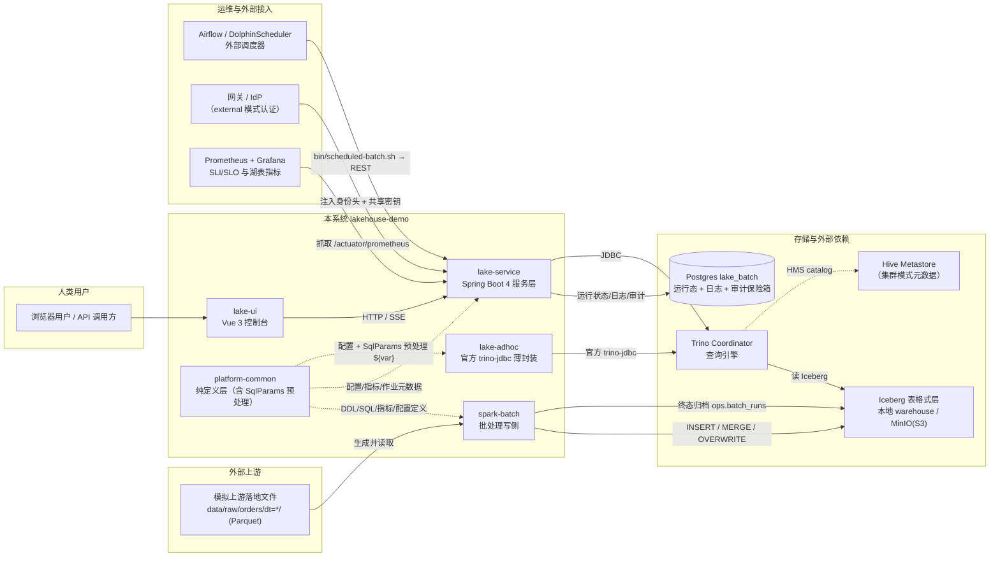

**关键外部边界**：① 上游落地文件是「模拟」的，由 IngestJob 自己生成；② Trino 是查询侧唯一入口，Spark 是写入侧主力；③ Postgres 只服务 lake-service 的运行态，不是湖仓数据的一部分；④ 外部调度器/网关/监控都只通过服务层接口接入，不直接碰湖表或运行态库。〔FACT｜README.md:7-21〕〔FACT｜batch/store/RunStateStore.java:10-13〕〔FACT｜scheduler/README.md:1-20〕

### 1.3 技术栈摘要

| 组件 | 版本 | 角色 |
|---|---|---|
| JDK | 11（批处理）/ 21（服务层） | Spark 3.5 官方支持到 17，服务层用 21 |
| Spark | 3.5.1 (Scala 2.12) | 批处理 |
| Iceberg | 1.5.2 | 表格式层，format-version=2，CoW |
| Trino | 476 | 即席查询（JDBC） |
| Spring Boot | 4.2.0 | WebFlux + Actuator（Reactor Netty） |
| Vue | 3.5 + Vite 7 | 控制台，构建产物进 `static/ui/` |
| 存储 | 本地 Hadoop catalog / MinIO(S3) | 由 `platform.warehouse` 决定 |
| 运行态库 | Postgres | `lake_batch.*` 与审计保险箱 |
| 监控 | Micrometer 1.18 + Prometheus 2.54 + Grafana 11 | `/actuator/prometheus` + 可选 `monitoring` profile |
| 外部调度 | Airflow 2+ / DolphinScheduler / crontab | 经 REST 触发，不直连 Spark |
| 存储清理 | bucket lifecycle + `remove_orphan_files` | S3/MinIO 非当前版本与孤儿文件 |

〔FACT｜README.md:23-37〕〔FACT｜pom.xml:30-50〕〔FACT｜infra/prometheus/prometheus.yml:1-20〕

### 1.4 仓库目录结构（第一级）

> 只列第一级目录，说清各自职责。是否入库以 `.gitignore` 为准。〔FACT｜.gitignore:1-33〕

| 目录 | 做什么的 | 入库 |
|---|---|---|
| `platform-common/` | **公共定义层**：归一化配置、三层表 DDL、转换 SQL、指标目录、作业元数据、SQL 脚本解析；`cli/SqlParams.java` 负责即席查询的 `${var}` 预处理。无框架依赖，被其他模块共用。 | ✅ |
| `lake-adhoc/` | **即席查询薄封装**：`SqlParams` 预处理 + 官方 `trino-jdbc` 执行 + 表格输出。协议层完全交给官方驱动，只保留参数化约定。 | ✅ |
| `spark-batch/` | **批处理写侧**：7 个 Spark 作业（init / ingest / transform / evolve / maintain / show / verify-sql），负责建表、入湖、分层加工与记账。 | ✅ |
| `lake-service/` | **服务层**：Spring Boot 4 应用，查询/语义/批作业/审计 REST + SSE，内置 Vue 控制台静态资源。 | ✅ |
| `lake-ui/` | **控制台前端**：Vue 3 + Vite 源码（查询台/表浏览/批作业/指标/配置五页），构建产物写进 `lake-service` 的 `static/ui/`。 | ✅（源码）/ ❌（产物） |
| `bin/` | **便捷脚本**：build、build-ui、dev-batch、infra、install-docker、lake-service、stack（一键全栈）、smoke（端到端冒烟）、scheduled-batch（调度器入口）、storage-lifecycle（bucket 规则）、submit-batch、trino-query；按用途分类见 §1.5。 | ✅ |
| `.github/workflows/` | **CI**：PR/push 构建 + 单测 + 脚本/DAG/JSON 静态校验，主分支 E2E（Docker infra + Trino + 冒烟）。 | ✅ |
| `scheduler/` | **外部调度接入示例**：Airflow DAG（每日 ingest→transform / 单独 maintain）、DolphinScheduler 任务入口与接入说明。 | ✅ |
| `conf/` | **配置**：`platform.properties.example`（集群模式模板）与本地生效的 `platform.properties`（含密钥，不提交）。 | 模板 ✅ / 本地 ❌ |
| `sql/` | **即席查询脚本**：`sql/adhoc/*.sql`，可直接交 Trino，也可经方言适配用 Spark 校验。 | ✅ |
| `infra/` | **基础设施编排**：Docker Compose（Postgres + MinIO + HMS + Trino）、全栈 override（`docker-compose.full.yml` + `lake-service` 镜像）、监控 profile（`prometheus/` + `grafana/`）、安全模板（`trino/auth/`、`docker-compose.security.yml`、`ranger/`）、存储生命周期（`storage/lifecycle.json`）及 HMS 补丁与使用说明。 | ✅ |
| `docs/` | **项目文档**：本 HLD（`docs/lakehouse-demo/`）与可观测性、安全、并发写、存储清理定义（`OBSERVABILITY.md` / `SECURITY.md` / `CONCURRENCY.md` / `STORAGE.md`）。 | ✅ |
| `warehouse/` | **Iceberg 本地存储根**：Hadoop catalog 模式下三张表的 `data/`（Parquet）与 `metadata/`（版本/快照/manifest）；由 `platform.warehouse` 指向，集群模式替换为 `s3a://lake/warehouse`。 | ❌ |
| `data/` | **模拟上游落地文件**：`data/raw/orders/dt=*/` 的 Parquet，由 IngestJob 生成，是入湖流的输入。 | ❌ |
| `logs/` | **运行日志**：`audit.log`、批作业 `batch/`、`lake-service.log`。 | ❌ |
| `spark-warehouse/` | Spark SQL 默认本地临时仓库（`spark.sql.warehouse.dir`），当前为空。 | ❌ |
| `.mvn/` | `jvm.config`：JDK 11+ 反射所需的 `--add-opens` 参数。 | ✅ |
| `.idea/` | IntelliJ IDEA 项目配置。 | ❌ |
| `.workbuddy/`、`.Trash-0/` | 工具记忆 / 回收站残留，与项目本身无关。 | ❌ |

根目录文件：`pom.xml`（Maven reactor 入口，声明 4 个模块）、`README.md`（快速开始与设计说明）、`lombok.config`、`.gitignore`、`.dockerignore`（全栈镜像构建上下文排除）。

**与后续章节的对应关系**：4 个 Maven 模块 + 1 个前端工程在第 3 章逐一展开；`conf/` 是 §4.1 配置流的起点；`data/` 与 `warehouse/` 分别是 §4.3 入湖流的「输入」与各作业的「存储落点」；`sql/` 是 §4.14 即席查询与 SQL 校验的输入；`logs/` 是 §7.3 日志出口之一。

### 1.5 脚本与工具清单（按用途分类）

`bin/` 下的 12 个脚本不是同一类东西。只有 `infra.sh` / `stack.sh` / `storage-lifecycle.sh` 是运维工具，
其余分别属于构建、本地开发、验证、查询、调度。按「谁用、什么时候用」分成 7 类：

#### 1.5.1 构建与打包（改代码后跑一次）

| 脚本 | 作用 | 前置 / 产出 |
|---|---|---|
| `bin/build.sh` | 全量构建 reactor：前端 → 4 个模块 jar → 预生成两个运行时 classpath | JDK 21；产出 `*/target/*.jar`、`spark-batch/target/classpath.txt`、`lake-adhoc/target/classpath.txt`；支持 `-DskipTests`、`-pl <module> -am` |
| `bin/build-ui.sh` | 只构建 Vue 控制台，产物写进 `lake-service/src/main/resources/static/ui` | Node 18+；`--clean` 先重装 `node_modules` |

#### 1.5.2 本地开发运行（人直接跑）

| 脚本 | 作用 | 说明 |
|---|---|---|
| `bin/dev-batch.sh` | 用预构建 classpath 直接起 Spark 作业（`--job all/ingest/transform/evolve/maintain/show/verify-sql`） | 必须先 `bin/build.sh`；运行时不再 `mvn package`，并发作业不抢 `target/` |
| `bin/lake-service.sh` | 服务层 `build / run / start / stop` | 默认 8088；后台日志 `logs/lake-service.out`；需要 JDK 21 |

#### 1.5.3 环境与全栈（运维 / 环境准备）

| 脚本 | 作用 | 说明 |
|---|---|---|
| `bin/infra.sh` | 起停本地 infra：`up [trino\|tools\|monitoring]`、`stop`、`restart`、`down`、`clean`、`ps`、`logs`、`doctor`、`psql` | 只管 Docker 容器，不碰 jar；默认只起 Postgres + MinIO + HMS |
| `bin/install-docker.sh` | 一次性安装 Docker Engine + Compose v2 + buildx | Ubuntu 22.04/24.04、Debian 12；可配 apt 镜像源 |
| `bin/stack.sh` | 一键全栈：infra + 宿主机批处理 + 容器化 `lake-service`；子命令 `up/down/clean/smoke/batch/logs/ps/build` | 容器内关闭批作业（`LAKE_BATCH_ENABLED=false`），批作业走 `stack.sh batch` |

#### 1.5.4 验证与质量（CI / 发布前）

| 脚本 | 作用 | 说明 |
|---|---|---|
| `bin/smoke.sh` | 端到端冒烟：健康 / 鉴权 / 查询 / SSE / 语义层 / 批作业 / 审计 / 只读守卫 / 指标抓取 | 宿主机 22 项、容器 19 项；失败非零退出；`SMOKE_BATCH=0` 跳过批作业 |

#### 1.5.5 查询与分析（人 / 脚本直接读湖表）

| 脚本 | 作用 | 说明 |
|---|---|---|
| `bin/trino-query.sh` | 即席查询 CLI：`--sql` / `--sql-file` / `--params` / `--stats` / `--list` / `--explain` / `--print-only` | `java -cp` 直起 `lake-adhoc`（classpath 由 `bin/build.sh` 预生成，不再走 Maven）；直连 Trino，无鉴权 / 配额 / 审计，面向运维和本地脚本 |

`sql/adhoc/*.sql` 是给 `trino-query.sh --sql-file` 用的查询资产，不是可执行工具；`@trino-only` 标记的语句由 `verify-sql` 跳过。

#### 1.5.6 调度与集群集成（机器调用）

| 脚本 / 文件 | 作用 | 说明 |
|---|---|---|
| `bin/scheduled-batch.sh` | 调度器 → `POST /api/batch/{job}`，按 `(job, 逻辑日期)` 生成幂等键，默认等终态 | 退出码 0/1/2 直接当调度任务状态；失败回显日志尾部 |
| `bin/submit-batch.sh` | 直接 `spark-submit` 到已有 YARN / K8s / standalone 集群 | 绕过 lake-service；前置 `spark-submit` 与集群可访问 Maven 仓库 |
| `scheduler/airflow/dag_lakehouse_daily.py` | 每日 `ingest → transform` DAG | 调 `scheduled-batch.sh`，不直跑 Spark |
| `scheduler/airflow/dag_lakehouse_maintain.py` | `maintain` 单独定时 DAG | 避免和写入抢资源 |
| `scheduler/dolphinscheduler/run_lake_job.sh` | DolphinScheduler SHELL 任务入口 | 参数：作业名 + 业务日期 |

#### 1.5.7 存储治理（对象存储管理员）

| 脚本 | 作用 | 说明 |
|---|---|---|
| `bin/storage-lifecycle.sh` | 把 `infra/storage/lifecycle.json` 应用到 S3 / MinIO bucket | 需要 AWS CLI v2 与 `AWS_ACCESS_KEY_ID` / `AWS_SECRET_ACCESS_KEY`；`--dry-run` 只打印 |

**怎么记**：`build*` 是构建期工具；`dev-batch` / `lake-service` / `trino-query` 是给人用的本地工具；
`infra` / `stack` / `storage-lifecycle` 是运维工具；`smoke` 是 CI / 发布检查；
`scheduled-batch` / `submit-batch` / `scheduler/*` 是给调度器或集群用的机器接口。

---

## 2. 架构总览

### 2.1 架构风格

系统采用**分层 + 旁路编排**的混合风格：

- **写侧（批处理）**：以 `platform-common` 为纯定义内核，`spark-batch` 为执行器，围绕 Iceberg 三层表构建一条线性 ETL 流水线。
- **读侧（服务）**：WebFlux 响应式服务层，查询走 Trino、编排走子进程，所有阻塞 IO offload 到虚拟线程。
- **旁路记账**：运行态写 Postgres、历史归档写湖表，二者通过 runId 对齐、通过对账互相恢复。
- **前端**：单页应用与接口同源托管，hash 路由，长任务用 SSE。

### 2.2 分层架构图

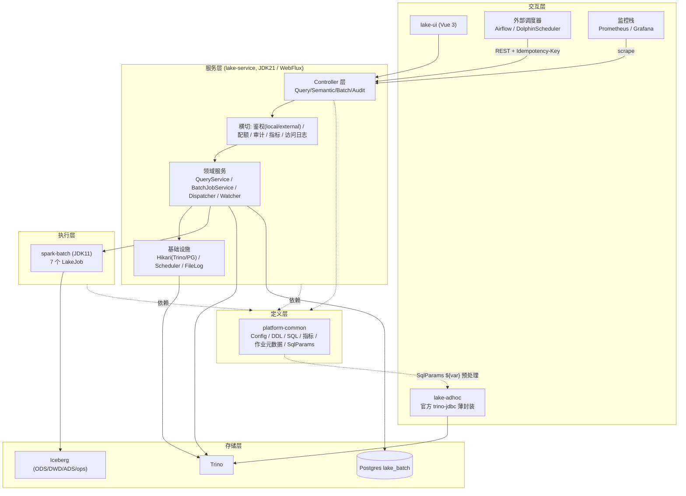

`platform-common` 是唯一被三层共同依赖的模块，且自身不依赖 Spark/Spring/Trino（pom 只有 lombok/slf4j/junit），因此是「纯定义层」。〔FACT｜platform-common/pom.xml:17-30〕

### 2.3 全局数据流总图（核心）

下图是全文的骨架——所有功能的数据流都可归到这五条主干：

```mermaid
flowchart LR
    CFG["配置源<br/>platform-defaults → conf/platform.properties → LAKE_* → -D"] -->|"PlatformConfig"| PC["配置对象"]
    PC -->|"sparkConf()"| SS["SparkSession"]
    PC -->|"trinoJdbcUrl()"| DS["Hikari 连接池"]

    RAW["模拟上游 Parquet<br/>data/raw/orders/dt=*"] -->|"① 生成+读取"| ING["IngestJob"]
    ING -->|"② INSERT 追加"| BRONZE[("bronze_orders<br/>ODS")]
    BRONZE -->|"③ MERGE 去重"| SILVER[("silver_orders<br/>DWD")]
    SILVER -->|"④ INSERT OVERWRITE 聚合"| GOLD[("gold_daily_revenue<br/>ADS")]

    GOLD -->|"Trino 读"| Q["查询链路<br/>SQL / 语义指标"]
    Q -->|"SSE meta/rows/done"| UI["Vue 控制台"]
    Q -.->|"审计指纹+保险箱"| AUDIT["audit.log + Postgres"]

    UI -->|"POST /api/batch/{job}"| SUB["作业提交 → QUEUED"]
    SUB -->|"Postgres"| RS[("lake_batch.batch_runs<br/>运行态")]
    RS -->|"Dispatcher 认领"| EXEC["子进程 BatchApp / K8s Job"]
    EXEC -->|"BATCH_RUN_ID 注入"| SPARK["spark-batch"]
    EXEC -->|"日志尾部"| LOG[("lake_batch.batch_log_lines")]
    SPARK -->|"终态归档"| OPS[("ops.batch_runs<br/>湖表")]
    RS -.->|"对账恢复"| OPS
    OPS -.->|"Trino 读历史"| UI
```

**五个主干**：① 配置流；② 数据入湖流；③ 分层加工流；④ 查询流；⑤ 作业编排流。下文第 4 章逐一展开。

### 2.4 请求处理主链路（服务层）

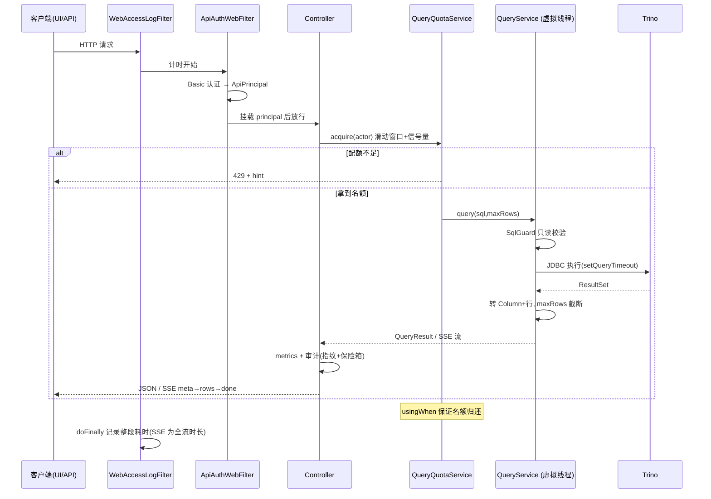

所有阻塞点（Hikari 取连接、`rs.next()`、子进程等待）均 `subscribeOn(blocking)` 到虚拟线程，Netty 事件循环只负责编排与订阅。〔FACT｜lake-service/config/LakeConfiguration.java:44-58〕〔FACT｜lake-service/query/service/QueryService.java:59,192〕

---

## 3. 模块划分

### 3.1 platform-common —— 公共定义层

- **职责**：产出「配置对象、表 DDL、转换 SQL、指标定义、作业元数据、runId」，自身不搬运数据。〔FACT｜platform-common/pom.xml:17-30〕
- **对外接口（数据视角）**：
  - 输入：配置文件 / 环境变量 / JVM 参数；输出：`PlatformConfig` 对象。〔FACT｜common/config/PlatformConfig.java:19-26,44-61〕
  - 输入：`PlatformConfig`；输出：6 条建表 DDL 字符串、MERGE/汇总 SQL、迁移 SQL、指标目录、作业清单（SQL 文本来自外置模板）。〔FACT｜common/catalog/LakeTables.java:48-65〕〔FACT｜common/catalog/TransformSql.java:26-58〕
- **依赖**：仅 lombok / slf4j / junit，零框架依赖。
- **关键约束**：指标目录是**编译期硬编码**（`SemanticCatalog.METRICS`），新增指标需改代码重新构建，不是运行时可配置目录。〔FACT｜common/semantic/SemanticCatalog.java:12〕

### 3.2 spark-batch —— 批处理写侧

- **职责**：跑 DDL、入湖、去重加工、schema 演进、表维护、巡检、SQL 校验，并把每次运行终态归档到湖表。
- **对外接口**：`BatchApp` 命令行入口（`--job` / `--days` / `--evolve` / `--run-id` …）；内部统一 `LakeJob.run(SparkSession, PlatformConfig, Args)`。〔FACT｜spark-batch/BatchApp.java:59-100〕〔FACT｜spark-batch/LakeJob.java:7-12〕
- **依赖**：`platform-common`（配置/DDL/SQL/作业名）。
- **关键约束**：所有 job 复用同一个 SparkSession；记账必须在 `spark.stop()` 之前完成。〔FACT｜spark-batch/BatchApp.java:94-115〕

### 3.3 lake-adhoc —— 即席查询薄封装

即席查询以 **`lake-adhoc` 模块**承载：协议层完全用**官方 `trino-jdbc` 驱动**（与 lake-service 查询链路同一套官方 client），项目只保留 `${var}` 参数化这一层业务约定和表格显示层，不重复实现客户端。原 `trino-adhoc` 已删除。〔FACT｜lake-adhoc/pom.xml:13-22〕〔FACT｜platform-common/cli/SqlParams.java:9-17〕

- **职责**：一次 JVM 内完成「`SqlParams` 预处理 → 官方 `trino-jdbc` 执行 → `TableFormatter` 表格输出」三件事。〔FACT｜lake-adhoc/TrinoQuery.java:17-22〕
- **对外接口**：`bin/trino-query.sh --sql-file` / `--sql` / `--list` / `--params` / `--explain` / `--print-only` / `--stats` / `--limit`。〔FACT｜lake-adhoc/TrinoQuery.java:180-200〕
- **依赖**：`platform-common`（配置 + `SqlParams` 复用 `SqlScript.split()` 切句）；官方 `trino-jdbc`（连接走 `PlatformConfig.trinoJdbcUrl()` / `trinoUser()` / `trinoSource()`，与 lake-service 同源）。〔FACT｜lake-adhoc/TrinoQuery.java:115-130〕
- **关键约束**：连接固定 `timezone=UTC`、`setReadOnly(true)`；`${var}` 替换与缺参跳过由 `SqlParams` 保证；客户端可截断行数（`--limit`，默认 200），不依赖 SQL 的 `LIMIT`。〔FACT｜lake-adhoc/TrinoClient.java:34-48〕〔FACT｜platform-common/cli/SqlParams.java:58-73〕

### 3.4 lake-service · 查询链路

- **职责**：把 SQL 查询、语义指标查询包装成 HTTP（JSON + SSE），负责鉴权、配额、只读校验、审计与指标。
- **对外接口**：`POST /api/query`、`POST /api/query/stream`、`GET/POST /api/semantics*`、`GET /api/tables*`、`GET /api/config`、`GET /api/audit*`。〔FACT｜README.md:119-135〕
- **依赖**：`platform-common`（配置 + 指标）；Trino（JDBC）、Postgres（审计保险箱）。
- **关键约束**：SQL 默认只读（`SqlGuard` 白名单），配额满返回 429，Trino 挂返回 503，健康检查如实报 DOWN。〔FACT｜query/SqlGuard.java:19-20〕

### 3.5 lake-service · 批作业编排链路

- **职责**：把 batch 作业包装成可提交、可排队、可跟踪、可恢复、跨实例共享状态的 HTTP 作业。
- **对外接口**：`POST /api/batch/{job}`、`GET /api/batch/runs[/{id}]`、`GET /api/batch/runs/{id}/events`。〔FACT｜controller/BatchController.java:43-74〕
- **依赖**：`platform-common`（runId / 作业白名单）；Postgres（运行态+日志）、Trino（读湖表历史）、本地进程或 K8s（执行）。数据库访问统一用 `spring-jdbc` 的 `JdbcTemplate` / `TransactionTemplate`（见 `LakeConfiguration.stateJdbc` / `stateTx`）；不再手写 `Connection`/`PreparedStatement`，SQL 行为用 H2 单测验证。〔FACT｜lake-service/pom.xml（spring-boot-starter-jdbc）〕〔FACT｜lake-service/config/LakeConfiguration.java:110-130〕
- **关键约束**：请求线程不直接 fork 子进程，只落 QUEUED；幂等键与 QUEUED 在同一事务内抢占；Dispatcher 在数据库行锁内检查名额并认领，多实例共享同一个并发上限。〔FACT｜batch/service/JobDispatcher.java:55-75〕

### 3.6 lake-ui —— Vue 3 控制台

- **职责**：五个页面（查询台 / 表浏览 / 批作业 / 指标 / 配置），与接口同源托管（8088），hash 路由。
- **对外接口**：调用 `lake-service` 的 HTTP/SSE；自身无后端。
- **依赖**：`/api/config` 提供作业卡片、表 FQN 等所有元数据，前端不硬编码。〔FACT｜lake-ui/store.js:37-41〕〔FACT｜controller/QueryController.java:143-166〕
- **关键约束**：全局状态在内存（Vue reactive），**只有 SQL 草稿写 localStorage**，查询结果只在内存不落盘。〔FACT｜lake-ui/store.js:4-12〕〔FACT｜README.md:210〕

### 3.7 工程化支撑与外部接入（非业务模块）

- **CI / 全栈 / 冒烟**：`.github/workflows/ci.yml` 在 PR/push 跑构建、单测、前端打包与脚本/DAG/JSON 静态校验，主分支额外跑 E2E；`bin/stack.sh` 一键起 infra + Trino + 容器化服务，`bin/smoke.sh` 做 22 项（容器 19 项）端到端检查。
- **服务层鉴权扩展**：`local` 静态账号用于 demo，`external` 模式改由网关注入身份头 + 共享密钥，无密钥 fail closed。
- **可观测性**：Micrometer + Prometheus registry 暴露 `/actuator/prometheus`，可选 `monitoring` profile 起 Prometheus/Grafana；`IcebergTableMetrics` 补表级指标。
- **外部调度**：`bin/scheduled-batch.sh` 是调度器与服务之间的薄契约，Airflow/DolphinScheduler/crontab 都通过它触发作业。
- **存储治理**：Iceberg 表属性 + bucket lifecycle + `remove_orphan_files` 三层清理。
- **脚本分类**：构建、本地开发、环境运维、验证、查询、调度、存储治理七类工具互不替代，
  完整清单与前置条件见 §1.5；本节只说明它们接入的架构位置。

---

## 4. 关键数据流详解（本文核心）

> 每个功能统一按「数据从哪儿来 → 经过什么处理 → 到哪儿去」三段式描述，并附数据流向图。

### 4.1 配置流：所有模块的输入源头

**从哪儿来**：五级覆盖，后者覆盖前者——
① classpath 内置 `platform-defaults.properties` → ② 工作目录 `conf/platform.properties`（存在且可读才加载）→ ③ `--conf` 指定的文件 → ④ 环境变量 `LAKE_*`（双下划线表连字符，如 `LAKE_S3_ACCESS__KEY`→`platform.s3.access-key`）→ ⑤ JVM `-Dplatform.*`（最高优先级）。〔FACT｜common/config/PlatformConfig.java:19-26,44-61,249-280〕

**怎么流转**：`PlatformConfig.load()` 输出一个配置对象，并做三类归一化：
- `warehouse()`：相对路径转 `file:///abs/path`，URI 原样保留并补尾 `/`；〔FACT｜common/config/PlatformConfig.java:107-115〕
- `sparkConf()`：生成 Iceberg extensions/catalog/warehouse、S3FileIO + endpoint/ak/sk、UTC 时区、动态分区覆盖、AQE 全套 Spark 参数；〔FACT｜common/config/PlatformConfig.java:141-180〕
- `trinoJdbcUrl()`：拼接 `jdbc:trino://host:port/catalog/database`。〔FACT｜common/config/PlatformConfig.java:204-212〕

**到哪儿去**：

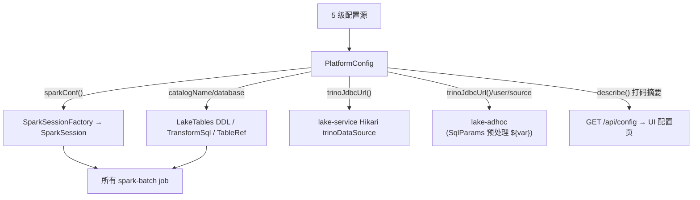

命令行覆盖必须在配置加载**之前**通过 `System.setProperty` 写入（系统属性优先级最高）。〔FACT｜spark-batch/BatchApp.java:65-77〕

服务层另有 `application.yml` 的 `lake.*` 配置（查询上限/鉴权账号/作业模板/状态库地址等），由 `LakeProperties` 绑定，与 `platform.*` 分工明确：前者管「服务怎么跑」，后者管「连哪个湖」。〔FACT｜lake-service/config/LakeProperties.java:16-22〕〔FACT｜lake-service/application.yml:32-92〕

### 4.2 建表流（init）：定义 → 库表

**从哪儿来**：DDL 文本外置在 `platform-common/src/main/resources/sql/ddl/`，由 `LakeTables.all(cfg)` 读模板并绑定配置，固定 6 条：建业务库 `lake` → 建运维库 `ops` → bronze → silver → gold → batch_runs。表名常量仍由 Java 持有，单测校验模板与常量不漂移。〔FACT｜common/catalog/LakeTables.java:48-65〕

**怎么流转**：`InitJob` 逐条 `spark.sql(ddl)`（全部 `IF NOT EXISTS`，幂等可重跑），随后 `prepareBatchRuns()` 用 `Migrations` 的 V1a/V1b 模板给老表补 `started_ms/finished_ms` 列并按 UTC 墙钟回填（列是否存在、是否有旧行的判断留在 Java），最后 `SHOW TABLES`。〔FACT｜spark-batch/job/InitJob.java:30-38,46-70〕

**到哪儿去**：Iceberg catalog——本地默认 `warehouse/lake/{bronze,silver,gold}`，接集群为 `s3a://lake/warehouse`；运维表写在 `<catalog>.ops.batch_runs`。〔FACT｜common/catalog/LakeTables.java:36-42〕

> 设计约束：建库 DDL 故意**不带 COMMENT**，因为 Hadoop catalog 拒绝 namespace 元数据。〔FACT｜platform-common/src/main/resources/sql/ddl/00_databases.sql〕

### 4.3 入湖流（ingest）：落地文件 → ODS

这是数据「进系统」的入口，分两个阶段。

**阶段一：生成模拟上游落地文件**
- 从哪儿来：无真实上游，IngestJob 按 `days`（默认 7）× `orders-per-day`（默认 2000）用**业务日期作随机种子**生成，保证同一天重跑数据可复现。〔FACT｜spark-batch/job/IngestJob.java:55-57,117-128〕
- 到哪儿去：`data/raw/orders/dt=YYYY-MM-DD/`，每天一个目录，Parquet + snappy，`mode("overwrite")` 整目录覆盖。〔FACT｜spark-batch/job/IngestJob.java:58-72〕
- 字段生成映射〔FACT｜spark-batch/job/IngestJob.java:134-155〕：

| 字段 | 生成规则 |
|---|---|
| `order_id` | `ORD-<dt>-<7位序号>`（带业务日期） |
| `user_id` / `merchant_id` | `U`+5位 / `M`+3位 |
| `category` | 从 5 类中随机（3C/FASHION/GROCERY/HOME/BEAUTY） |
| `amount` / `currency` | round(10+r*990,2) / 固定 CNY |
| `status` | 6% REFUNDED、4% CANCELLED、其余 PAID |
| `event_time` | 当天（或前一天）+ 随机小时 |
| **迟到数据 10%** | 10% 概率把 event_time 落到前一天 |
| **重复单 ~3%** | PAID 单再造一条 event_time+2h、status=REFUNDED 的记录 |

**阶段二：落地文件 → bronze_orders**
- 从哪儿来：只读本次生成的 dt 目录（`mergeSchema=true`）。〔FACT｜spark-batch/job/IngestJob.java:78-79〕
- 怎么流转：`INSERT INTO bronze SELECT 原字段 + current_timestamp() AS ingest_time + input_file_name() AS source_file + <runId> AS run_id`——**纯追加，不做更新**。〔FACT｜spark-batch/job/IngestJob.java:80-88〕
- 到哪儿去：`iceberg.lake.bronze_orders`。分区**不在 SQL 里指定**，由 Iceberg 依表定义 `days(event_time)` 自动按事件时间路由——所以迟到数据进正确的历史分区，与上游 dt 目录解耦。〔FACT｜common/catalog/LakeTables.java:117〕
- 老表升级：缺 run_id 列则 `ADD COLUMNS`，并删掉 run_id 为空的历史行。〔FACT｜spark-batch/job/IngestJob.java:99-113〕

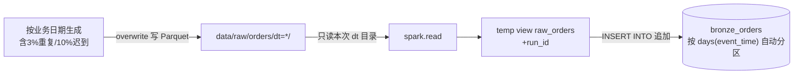

> 设计取舍：ODS 只追加、不幂等；幂等收敛交给 DWD 的 MERGE。〔FACT｜spark-batch/job/IngestJob.java:31-33〕

### 4.4 分层加工流（transform）：ODS → DWD → ADS

`--days`（默认 7）只扫近 N 天分区，靠 Iceberg 分区裁剪控制扫描量。〔FACT｜spark-batch/job/TransformJob.java:27,34〕

**第一步：bronze → silver（MERGE 去重）**〔FACT｜common/catalog/TransformSql.java:18-36〕
- 从哪儿来：bronze 近 N 天（`event_time >= current_date() - INTERVAL days DAYS`）。
- 怎么流转：内层 `row_number() OVER (PARTITION BY order_id ORDER BY event_time DESC, ingest_time DESC)` 只取 `rn=1`（同一订单取最新事件）；派生 `is_refund = status='REFUNDED'`、`dt = cast(event_time as date)`、`updated_at = current_timestamp()`；按 `order_id` 匹配，`WHEN MATCHED AND s.event_time > t.event_time THEN UPDATE SET *`，`WHEN NOT MATCHED THEN INSERT *`。
- 到哪儿去：`silver_orders`（增量 upsert，只更新真正变了的行）。

**第二步：silver → gold（INSERT OVERWRITE 汇总）**〔FACT｜common/catalog/TransformSql.java:46-62〕
- 从哪儿来：silver，过滤 `status <> 'CANCELLED'`（取消单不计入）。
- 怎么流转：按 `dt, merchant_id, category` 聚合：

| 输出字段 | 口径 |
|---|---|
| `order_cnt` | `count(*)` |
| `buyer_cnt` | `count(DISTINCT user_id)`（该粒度下去重，**跨行不可相加**） |
| `gmv` | `sum(amount)` |
| `refund_amount` | `sum(CASE WHEN is_refund THEN amount ELSE 0 END)` |
| `net_revenue` | `sum(CASE WHEN is_refund THEN 0 ELSE amount END)`（GMV−退款） |

- 到哪儿去：`gold_daily_revenue`，`INSERT OVERWRITE` + Iceberg 动态分区覆盖（只替换出现的分区）。〔FACT｜common/catalog/TransformSql.java:49〕

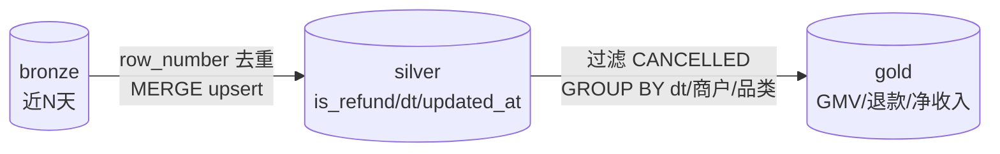

### 4.5 schema 演进流（evolve）

- 从哪儿来：`silver_orders`。
- 怎么流转：若未含 `channel` 列则 `ALTER TABLE ADD COLUMNS (channel STRING)`（纯元数据变更）；再 `UPDATE silver SET channel = CASE pmod(hash(user_id),3) ...`（按 user_id 哈希稳定分流 APP/MINI_APP/WEB），CoW 重写受影响数据文件。〔FACT｜spark-batch/job/EvolveJob.java:28-41〕
- 到哪儿去：仍是 silver 表的新快照；老快照只有旧列，读新快照缺值时自动返回 NULL。〔FACT｜spark-batch/job/EvolveJob.java:16-17〕

### 4.6 表维护流（maintain）

- 从哪儿来：三张业务表的数据文件与 Iceberg 元数据。
- 怎么流转：逐表执行四个 Iceberg `CALL system.*` 存储过程——① `rewrite_data_files`（合并小文件，min-input-files=2、target 32MB）；② `rewrite_manifests`（控元数据规模）；③ `expire_snapshots`（清理快照，`retain_last` 默认 5）；④ `remove_orphan_files`（清理没有被任何有效快照引用、且早于 `--orphan-retention-hours`（默认 168h）的孤儿文件）。顺序是先过期快照再清孤儿文件，否则刚过期的快照引用的文件还不敢删。〔FACT｜spark-batch/job/MaintainJob.java:40-82〕
- 到哪儿去：重写后的数据文件、manifest、被裁剪的快照与孤儿文件（数据内容不变）。对象存储侧再配合 bucket lifecycle 清未完成分片与非当前版本，见 `docs/STORAGE.md`。〔FACT｜infra/storage/lifecycle.json:1-22〕

### 4.7 即席查询流（SQL，JSON 接口）——读侧主干

**从哪儿来**：客户端 POST `/api/query` 的 `{sql, maxRows}`；账号名来自 `ApiPrincipal`，IP 来自请求。〔FACT｜controller/QueryController.java:49-57〕

**怎么流转**：

```
HTTP {sql,maxRows}
 → WebAccessLogFilter（计时）→ ApiAuthWebFilter（Basic→ApiPrincipal）
 → QueryController: quotas.acquire(actor)（拿不到→429）
 → QueryService.query: SqlGuard 只读校验 → Hikari trinoDataSource → Trino 执行
 → ResultSet 转 Column + List<List<String>>
    · maxRows = min(请求值, 服务端上限 1000)，多读一行后置 truncated=true 并 break
    · 值格式化：BigDecimal→toPlainString、Timestamp→ISO 绝对时刻、byte[]→<binary N>
 → QueryResult{columns, rows, rowCount, truncated, elapsedMs, stats}
 → metrics.queryExecuted + AuditService.record（SQL 指纹）+ 保险箱（脱敏+AES-GCM）
```

〔FACT｜query/service/QueryService.java:79-121,292-315〕〔FACT｜controller/QueryController.java:58-79〕

**到哪儿去**：`QueryResult` JSON 返回客户端；同时三路副作用——Micrometer 指标（`/actuator/metrics`）、审计日志 `logs/audit.log` + 内存缓冲、Postgres `lake_audit.query_text` 原文保险箱。〔FACT｜OBSERVABILITY.md:3-5〕

**只读校验 `SqlGuard`**：白名单放行 `select/with/show/describe/desc/explain`，拒绝多语句；因 `EXPLAIN ANALYZE` 会真实执行内层语句且 Trino JDBC 的 `setReadOnly` 只是驱动标记，只读模式会「看穿」内层递归校验（最多 5 层）。〔FACT｜query/SqlGuard.java:19-22,51-68〕

### 4.8 语义指标流（semantics）

指标目录数据**来自静态定义** `SemanticCatalog.METRICS`（编译期硬编码），共 5 个指标，全部指向 `gold_daily_revenue`：〔FACT｜common/semantic/SemanticCatalog.java:12-22〕

| 指标 | 口径（measure） |
|---|---|
| `gmv` 成交总额 | `sum(gmv)` |
| `orders` 有效订单数 | `sum(order_cnt)` |
| `buyers` 下单人数 | `sum(buyer_cnt)`（跨维度不可相加） |
| `net_revenue` 净收入 | `sum(net_revenue)` |
| `refund_rate` 退款率 | `sum(refund_amount) / nullif(sum(gmv), 0)` |

三个 API 的数据流：

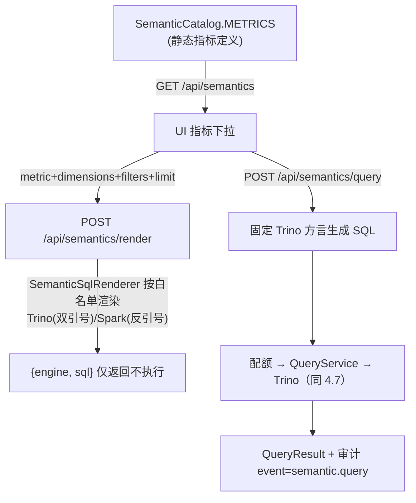

- **render 不执行 SQL、不查 Trino、不占配额、不审计**，只给调用方拿多引擎方言的 SQL；两方言口径一致、仅标识符引号不同。〔FACT｜controller/SemanticController.java:71-76,102-110〕〔FACT｜common/semantic/SemanticSqlRenderer.java:12-18〕
- **query 固定 Trino 方言**（即使传 engine=spark），复用查询链路，审计事件名 `semantic.query` 并附带 metric。〔FACT｜controller/SemanticController.java:78-99〕
- 渲染器对表名/维度/过滤字段做白名单校验，字面量按类型渲染（`dt` 必须是 `yyyy-MM-dd`，数值直出，其余单引号转义），不成为新的注入入口。〔FACT｜common/semantic/SemanticSqlRenderer.java:51-129〕

> 口径已统一：`refund_rate` 语义层口径为 `sum(refund_amount) / nullif(sum(gmv), 0)`（比例、防除零）；ad-hoc 脚本 `01_daily_revenue.sql` 的 `refund_rate` 已对齐同一表达式（保留 4 位小数），二者分子/分母、除零处理、返回尺度完全一致。两处已通过注释**双向回指**防漂移：语义层 `SemanticCatalog` 注明 ad-hoc 脚本须与此一致，ad-hoc 脚本注明口径来源；改动任一处都应同步另一处。另 `06_refund_by_category.sql` 的 `refund_rate_pct` 是「退款订单数占比」（按订单数、扫 silver 明细），属不同业务概念，不在本口径范围。〔FACT｜common/semantic/SemanticCatalog.java:21-24〕〔FACT｜sql/adhoc/01_daily_revenue.sql:4,11〕

### 4.9 SSE 流式查询流

**从哪儿来**：`POST /api/query/stream`（用 POST 而非 GET，避免 SQL 进 URL 被访问日志记录且受长度限制）。〔FACT｜controller/QueryController.java:88-94〕

**怎么流转**：与 JSON 接口共用配额、SqlGuard、Trino 执行；`streamQuery()` 用 `Flux.create` 边读 ResultSet 边发，每 200 行发一批。事件顺序：

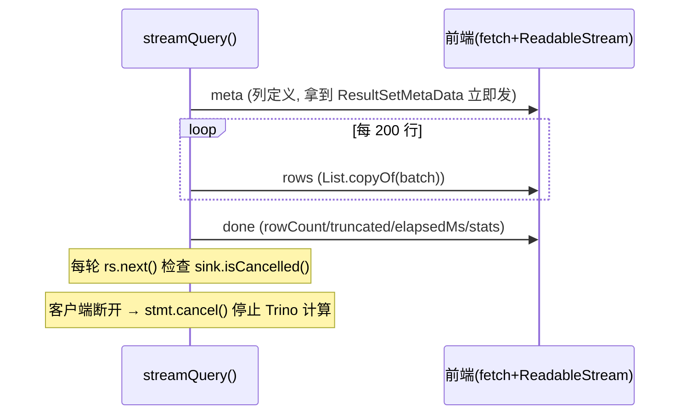

异常时经 `onErrorResume` 翻成 `error` 事件（响应头已是 200 无法改状态码）。〔FACT｜controller/QueryController.java:99-119〕〔FACT｜query/service/QueryService.java:123-192〕

**到哪儿去**：前端 `QueryView` 按 `meta→rows→done→error` 增量渲染 `ResultTable`。〔FACT｜lake-ui/views/QueryView.vue:96-146〕

### 4.10 批作业编排流：提交 → 执行 → 终态（最重要）

这是系统最复杂的数据流，核心是**三条运行记录通道分离**。

#### 三条数据通道

| 通道 | 存储 | 写入方 | 生命周期 |
|---|---|---|---|
| ① 服务侧运行态 | Postgres `lake_batch.batch_runs`（非湖表） | lake-service `JdbcRunStateStore` | 多实例共享，重启不丢 |
| ② 共享日志尾部 | Postgres `lake_batch.batch_log_lines` | 执行器 → `JdbcLogStore` | 每 run 留尾 2000 行，7 天 |
| ③ 湖表历史归档 | Iceberg `ops.batch_runs`（经 Trino 读） | **spark-batch** `RunRecordWriter` | 长期、跨进程的权威归档 |

〔FACT｜batch/store/RunStateStore.java:10-13〕〔FACT｜batch/store/JdbcRunStateStore.java:32〕〔FACT｜batch/store/JdbcLogStore.java:26-27〕

#### 主链路（提交到终态）

```mermaid
sequenceDiagram
    participant UI as JobsView
    participant Ctl as BatchController
    participant Svc as BatchJobService
    participant PG as lake_batch.batch_runs
    participant D as JobDispatcher
    participant E as LocalProcessJobExecutor
    participant BP as BatchApp 子进程
    participant LK as Iceberg ops.batch_runs

    UI->>Ctl: POST /api/batch/{job} (+Idempotency-Key)
    Ctl->>Svc: submit(job, key)（offload blocking）
    Svc->>Svc: 白名单→幂等→RunIds.generate→模板拼命令→建日志目录
    Svc->>PG: insert(QUEUED, owner=本实例)
    Svc-->>UI: 202 + BatchRun
    UI->>UI: follow(id) 建 SSE
    loop 每 1s
        D->>PG: 行锁内 claimNextIfSlotAvailable(owner,max) → QUEUED→RUNNING
        D->>E: executor.start(注入 BATCH_RUN_ID, stdout→{id}.log)
        E->>BP: java -cp 启动预构建的 BatchApp
        BP->>BP: RunIds.resolve(BATCH_RUN_ID) → 跑 job
        BP->>LK: finally 写终态(epoch 毫秒, 失败不改退出码)
        E->>PG: 每500ms flush 日志; 退出→completed
        E->>PG: state.finish(终态) + 审计
    end
    Note over UI: BatchWatcher 推 status/log/end SSE
```

**关键数据节点**：
1. **提交**：`BatchJobService.submit` 做白名单校验（`LakeJobs.CHOICES`）、快路径幂等命中查询、`RunIds.generate()` 生成 runId、命令模板 `bin/dev-batch.sh --job {job}` 拼命令、建日志目录；带幂等键时由 `insertWithIdempotency` 在事务内抢占键并写入 QUEUED，并发重复提交只有一个胜出。〔FACT｜batch/service/BatchJobService.java:119-170〕
2. **认领**：Dispatcher 每 1s 扫描，`claimNextIfSlotAvailable` 在同一把数据库行锁里做「RUNNING 数 < max」检查与条件 UPDATE 认领，多实例既不重复执行也不越过 `max-concurrent-jobs`（默认 2）。〔FACT｜batch/service/JobDispatcher.java:55-75〕〔FACT｜batch/store/JdbcRunStateStore.java:219-260〕
3. **执行**：本地执行器把 stdout/stderr 重定向到 `logs/batch/{id}.log`，注入 `BATCH_RUN_ID` 与 `BATCH_RUN_LOG` 环境变量；虚拟线程循环 `waitFor(500ms)` + 每轮 flush 日志到 Postgres，退出码 0→SUCCEEDED/非 0→FAILED/超时→TIMEOUT。〔FACT｜batch/service/LocalProcessJobExecutor.java:33-93〕
4. **终态回流**：`JobCompletionService.completed()` 写终态到运行态库、令湖表历史缓存失效、打指标与审计。〔FACT｜batch/service/JobCompletionService.java:21-35〕
5. **runId 对齐**：服务端生成 runId → 注入子进程 → `RunIds.resolve` 取出 → 既写 bronze 每行、又写 `ops.batch_runs`，二者指向同一批次。〔FACT｜common/batch/RunIds.java:14-19〕〔FACT｜spark-batch/BatchApp.java:80-88〕

**K8s 执行方式**：`executor=kubernetes` 时改为通过 K8s Job API 创建 Job（JWT 从 in-cluster ServiceAccount 读取），注入同样的环境变量；终态不再定时轮询，而是用 `watch=true` 长连接把 Job status 变化推成 NDJSON 事件，虚拟线程收到 `succeeded`/`failed` 立即回调，服务端按 `timeoutSeconds` 关流后带 `resourceVersion` 续接、410 Gone 则重新建连。〔FACT｜batch/service/KubernetesJobExecutor.java:69-108,115-198〕

**K8s 日志搬运**：Job 的 Pod 模板带 `lake-job=<jobName>` 标签，日志线程 watch 该标签的 PodList，
拿到 Pod 名且 `status.phase` 离开 `Pending` 后用 `GET .../pods/{pod}/log?follow=true` 持续读 stdout/stderr，
按 100 行/1 秒批量写进同一个 `LogStore`（`lake_batch.batch_log_lines`）；日志接口偶发 4xx（容器刚起的竞态）
才短退避重试。终态到达后先等日志读到 EOF（最长 2 秒），再置停止位并关掉 watch / follow 长连接，
避免虚拟线程挂在长连接上。这样 tail / SSE 在 K8s 模式下也从状态库读，和本地模式一致，不依赖 Pod 是否还在、
也不要求请求落到提交 Job 的那台实例。〔FACT｜batch/service/KubernetesJobExecutor.java:202-344,406-428〕〔FACT｜batch/store/LogStore.java:7-10〕

**外部调度触发**：调度器不直接跑 Spark，而是调 `bin/scheduled-batch.sh` → `POST /api/batch/{job}`。
幂等键取 `lake-<job>-<逻辑日期>`（Airflow 用 `{{ ds }}`、DS 用 `${bizdate}`），同一逻辑日重跑返回同一条
运行记录；脚本默认等终态，退出码 0/1/2 直接当调度任务状态，失败时回显日志尾部。
`ingest → transform` 每日串跑，`maintain` 单独定时。详见 §4.15 与 `scheduler/README.md`。
〔FACT｜bin/scheduled-batch.sh:1-25〕〔FACT｜scheduler/README.md:1-30〕

### 4.11 运行历史读取与僵死恢复流

**读历史**：`GET /api/batch/runs` → `BatchJobService.list()` = 运行态库 `state.recent()` ∪ 湖表 `BatchHistoryService.recent()`（经 Trino 读 `ops.batch_runs`），按 id 合并、终态优先、按 started_ms 倒序。湖表读不到时降级为提示（`RunsView.history`），不把接口打成 500。〔FACT｜batch/service/BatchJobService.java:167-190〕〔FACT｜batch/model/RunsView.java:8-16〕

**僵死恢复**（每 60s 对账）：

```
staleRunning(now - 120s) → 查湖表 ops.batch_runs
   ├─ 拿到终态 → state.finish(采纳湖表终态)
   └─ 无终态 → state.markLost("实例失联", exit_code=1)
顺便 purge 过期日志(7d) 与过期审计原文
```

〔FACT｜batch/service/BatchJobService.java:82-112〕

### 4.12 审计与可观测流

- **审计三重出口**：`AuditService.record()` 生成 UUID eventId → 写 `logs/audit.log`（90 天滚动，独立 logger）+ 内存环形缓冲（最近 200 条，`GET /api/audit`）+ 返回 eventId 供保险箱关联。SQL 只写 SHA-256 前 16 位指纹，不写原文/口令。〔FACT｜observability/AuditService.java:14-47〕〔FACT｜OBSERVABILITY.md:45-58〕
- **原文保险箱**（可选）：开启后 SQL 经 `SqlRedactor` 启发式脱敏 → AES-GCM 加密（eventId 作 AAD）→ Postgres `lake_audit.query_text`，同时记录 `key_id`；密钥按 `key_id` 组成密钥环，轮换后旧原文仍可读，缺密钥/解密失败会抛错并计 `lake.audit.vault.decrypt.error`，不再伪装成 404；读取需 AUDITOR 角色且每次读取再写一条审计。〔FACT｜observability/AuditTextStore.java:49-165〕〔FACT｜OBSERVABILITY.md:60-100〕
- **指标**：Micrometer 埋点同时经 `/actuator/metrics`（人看）与 `/actuator/prometheus`（抓取，需 BATCH 角色）暴露；内置 `micrometer-registry-prometheus`，名字含 `lake.query.*` / `lake.batch.*` / `lake.auth.denied` / `lake.iceberg.*`。SLI/SLO、PromQL 与 5 条告警规则见 `docs/OBSERVABILITY.md` 与 `infra/prometheus/rules/lake-slo.yml`。〔FACT｜observability/LakeMetrics.java:11-24〕〔FACT｜observability/IcebergTableMetrics.java:23-30〕
- **湖表指标采集**：`IcebergTableMetrics` 每 60s 经 Trino 查 `iceberg.lake."{table}$files"` / `$snapshots`，把文件数、平均文件大小、总字节数、快照数写成带 `table` 标签的 gauge；Trino 没起或表不存在时保留上次值，不影响启动。Grafana 面板已加「Iceberg 文件数/快照数」「平均文件大小」两屏。〔FACT｜observability/IcebergTableMetrics.java:35-140〕〔FACT｜infra/grafana/dashboards/lake-service-slo.json:100-140〕
- **监控栈**：可选 `monitoring` profile 起 Prometheus（host 网络，抓 `127.0.0.1:8088`，basic_auth=operator）与 Grafana（数据源/面板自动装载），同一 target 同时覆盖宿主机服务与全栈容器服务。〔FACT｜infra/docker-compose.yml:161-212〕〔FACT｜infra/prometheus/prometheus.yml:1-25〕

### 4.13 前端控制台流（lake-ui）

- **查询台**：SQL 来源优先级 = URL `?sql=` > `store.draftSql`（表浏览跳转）> localStorage > 空；执行走 `POST /api/query/stream` + SSE；离开页面 `AbortController.abort()` 取消流。〔FACT｜lake-ui/views/QueryView.vue:70-105,149-167〕
- **表浏览**：`/api/tables` 拿清单（表头中文名来自 DDL COMMENT）→ 点表 `/api/tables/{t}/sample`；「在查询台打开」写 `store.draftSql` 后跳转，实现跨页数据流。〔FACT｜lake-ui/views/TablesView.vue:24-74〕
- **批作业**：作业卡片来自 `/api/config` 下发的 `LakeJobs.METAS`；提交 POST、6s 轮询列表、SSE 跟随日志（退避重连），后台标签页断 SSE。〔FACT｜lake-ui/views/JobsView.vue:39-96,116-240〕
- **指标页 / 配置页**：分别消费 `/api/semantics*` 与 `/api/config`。〔FACT｜lake-ui/views/SemanticView.vue:37-81〕〔FACT｜lake-ui/views/ConfigView.vue:10-71〕

### 4.14 即席查询流（lake-adhoc：官方 trino-jdbc + SqlParams）

```
bin/trino-query.sh --sql-file <脚本> [--params k=v] [--explain] [--print-only]
  → shell 把参数原样交给 java（只把 --sql=... 拆成 --sql value），不再落临时文件
  → java -cp 直起（lake-adhoc/target/classes + platform-common/target/classes + 预生成 classpath.txt）
       com.demo.lake.adhoc.TrinoQuery：
       ① PlatformConfig.load() 拿 trinoJdbcUrl()/trinoUser()/trinoSource()
       ② SqlParams.prepare()：SqlScript.split() 精确切句（跳过注释/字符串里的分号）
          · ${key} → value 替换；仍有残留占位符 = 缺参，整条语句跳过
          · --explain 时给语句加 EXPLAIN 前缀
       ③ TrinoClient.connect()：官方 trino-jdbc，timezone=UTC + setReadOnly(true)
       ④ 逐条 stmt.executeQuery() → ResultSet 转列/行（--limit 截断）→ TableFormatter 带边框表格
          · --stats 时从 TrinoResultSet.getStats() 取 queryId/splits/rows/peakMem
  → 输出：+----+ 边框表格（CJK 宽字符对齐由 TableFormatter 处理）
```

〔FACT｜bin/trino-query.sh:1-47〕〔FACT｜bin/build.sh:91-101〕〔FACT｜lake-adhoc/TrinoQuery.java:39-113〕〔FACT｜lake-adhoc/TrinoClient.java:34-98〕

**结果输出**：自研的 `TableFormatter`（纯显示层，约 110 行）按 code point 计算显示宽度，组合符号占 0 列、CJK/全角/emoji 占 2 列，实测中文表头不错位；`Timestamp` 输出 ISO-8601 绝对时刻，不受 JVM 时区影响。这是在官方 JDBC 驱动之上唯一保留的自研显示逻辑。

与「官方 CLI 方案」相比：删掉了 `docker exec` / `TERM=dumb` / `--output-format=ALIGNED` 等进程外适配，链路从两次进程启动缩短为一次；classpath 由 `bin/build.sh` 预生成后，运行时也不再启动 Maven（实测单次查询约 0.6s，旧 `mvn exec:java` 约 3s+）。结果行数恢复客户端截断（`--limit`，默认 200），不再依赖 SQL 的 `LIMIT`。保留的能力：`--params` 的 `${var}` 替换与缺参跳过、`--explain`、`--list`、`--print-only`、`--stats`。

**端到端实测**（Trino 476 容器，2026-11-20，官方 trino-jdbc 版）：中文列对齐、真实数据查询、`--stats` 的 QueryStats 输出均正常；`01_daily_revenue.sql` 返回近 7 天大盘（列含 `refund_rate`，值为 0.09 的比例，与语义层口径一致）；`04_time_travel.sql --params snapshot_id=<真实快照ID>` 三条语句（快照列表 / 按快照读 / 按时间点读）均正常执行；不带参数时缺参语句正确跳过。

另有 `VerifySqlJob`（批处理侧）：读 ad-hoc 脚本 → 跳过 `@trino-only` 语句 → `TrinoDialect.toSpark()` 做最小方言适配（`date_add`→`date_sub`、`INTERVAL '1' DAY`→`INTERVAL 1 DAYS`）→ `spark.sql` 校验，不落表。〔FACT｜spark-batch/job/VerifySqlJob.java:34-65〕〔FACT｜common/sql/TrinoDialect.java:18-61〕

### 4.15 外部调度触发流（Airflow / DolphinScheduler）

```
调度器（Airflow DAG / DS Shell 任务 / cron）
  → bin/scheduled-batch.sh --job <job> --date <逻辑日期> --wait
      ① 生成幂等键 lake-<job>-<YYYY-MM-DD>（日期来自 {{ ds }} / ${bizdate}）
      ② POST /api/batch/{job} + Idempotency-Key + Basic（或网关头）
      ③ 202 + runId；同一键重跑返回同一 runId（服务日志「幂等命中」）
      ④ 轮询 GET /api/batch/runs/{id}?tail=20 直到 SUCCEEDED / FAILED / TIMEOUT
  → 退出码 0/1/2 = 调度任务状态；失败时打印 message + 日志尾部
```

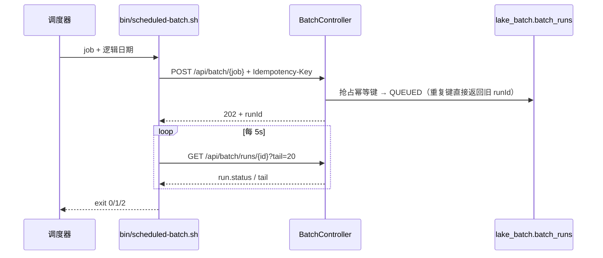

**关键约束**：① 调度器只拿「提交 + 终态」两个语义，不知道 Spark 命令，也不知道 Postgres 在哪；
② 幂等键是 `(job, 逻辑日期)`，重跑/重试不会产生第二条运行记录；
③ `maintain` 不在每日链里，单独定时，避免和写入抢资源。
〔FACT｜bin/scheduled-batch.sh:27-136〕〔FACT｜scheduler/airflow/dag_lakehouse_daily.py:20-47〕〔FACT｜scheduler/airflow/dag_lakehouse_maintain.py:12-33〕

### 4.16 湖表指标采集流（$files / $snapshots）

```
Trino metadata 表（iceberg.lake."{table}$files" / $snapshots）
  ← IcebergTableMetrics 虚拟线程每 60s 查一次（经 trinoDataSource，只读）
  → Micrometer gauge：lake.iceberg.files / avg_file_size_bytes / total_size_bytes / snapshots（tag=table）
  → /actuator/prometheus → Prometheus 抓取 → Grafana 面板
```

**为什么用 Trino 而不是 Iceberg 客户端**：服务侧已经有只读 Trino 连接池，元数据表查询只是两条 SQL，
不需要再引一个 Iceberg runtime 依赖（版本与 Spark 绑死，容易冲突）。表名做白名单校验（`[A-Za-z0-9_]+`），
`$` 元数据表名整体加双引号；查询失败只 debug 记日志并保留上次 gauge 值。
〔FACT｜observability/IcebergTableMetrics.java:35-140〕〔FACT｜lake-service/src/main/resources/application.yml:38-46〕

---

## 5. 数据模型概览

### 5.1 核心实体关系图（ER）

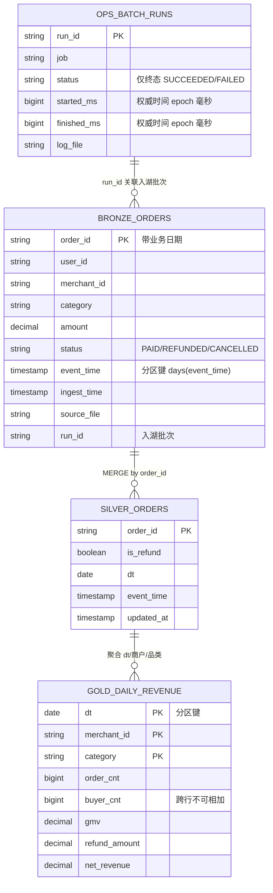

### 5.2 运行态库表（Postgres，服务私有）

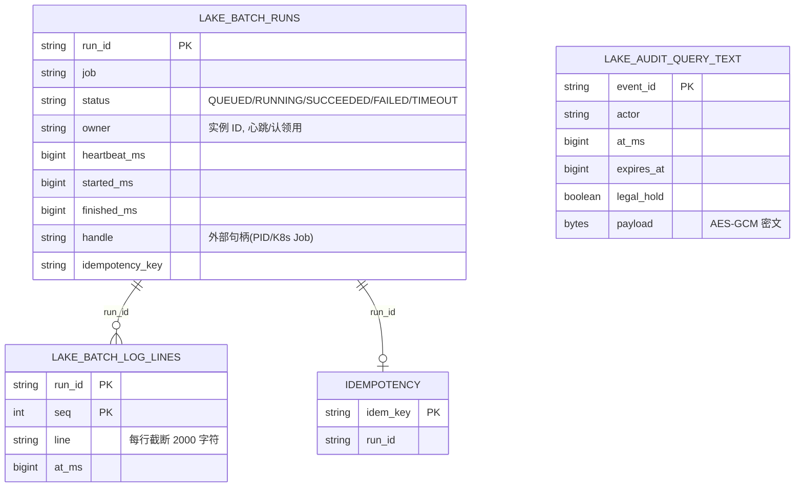

〔FACT｜lake-service/src/main/resources/sql/state/30_batch_runs.sql〕〔FACT｜lake-service/src/main/resources/sql/state/40_batch_log_lines.sql〕〔FACT｜lake-service/src/main/resources/sql/state/50_query_text.sql〕

### 5.3 关键字段说明

| 字段 | 所在 | 说明 |
|---|---|---|
| `run_id` | bronze / ops.batch_runs / lake_batch.batch_runs | 跨模块贯穿的批次标识，服务端与 spark-batch 共用 `RunIds` 生成器，使湖表记录与数据行可 join 回溯。〔FACT｜common/batch/RunIds.java:14-19〕 |
| `started_ms`/`finished_ms` | ops.batch_runs | **权威时间**，epoch 毫秒，绝对时刻不受时区影响；旧 `started_at/finished_at` 墙钟列已废弃。〔FACT｜common/catalog/LakeTables.java:69-71〕 |
| `buyer_cnt` | gold | （商户,品类）粒度去重用户数，**跨行相加是"人次"不是全站买家数**。〔FACT｜common/catalog/LakeTables.java:154〕 |
| `event_time` | bronze/silver | 隐藏分区 `days(event_time)` 的来源，迟到数据进正确历史分区。〔FACT｜common/catalog/LakeTables.java:117〕 |

---

## 6. 关键设计决策（ADR 风格）

### ADR-1：行级写一律 CoW（copy-on-write），不用 MoR
- **背景**：Trino（读侧）处理 MoR 的 delete file 跨引擎易踩坑，版本不齐会静默出错。〔FACT｜README.md:309-313〕
- **选项**：CoW（写放大换零兼容问题）vs MoR（写友好但读侧复杂）。
- **采用**：CoW，`format-version=2`，`write.merge/update/delete.mode=copy-on-write`。
- **后果**：写放大；如需 MoR 可打开 `platform.write-mode=merge-on-read`（两端版本都验证过后）。

### ADR-2：ODS/DWD 用 `days(event_time)` 隐藏分区，不用入湖日期
- **背景**：上游落地文件按 `dt` 分目录，但业务关心事件时间；迟到数据若按入湖日期分区会错位。
- **采用**：按事件时间路由分区，迟到数据进正确的历史分区，无需重跑整个目录。〔FACT｜README.md:315-317〕
- **后果**：分区路由由 Iceberg 自动完成，SQL 不显式指定分区。

### ADR-3：去重用 `MERGE` + `row_number()`，不做全量覆盖
- **背景**：3% 重复单、10% 迟到数据需要修正，全量覆盖代价太大。
- **采用**：按 order_id 取最新事件，`WHEN MATCHED AND s.event_time > t.event_time` 只更新变化行，只扫近 N 天分区。〔FACT｜README.md:319-321〕
- **后果**：重复/迟到的修正代价被限制在变化行与近 N 天分区。

### ADR-4：时间是权威 epoch 毫秒，不靠时区约定
- **背景**：墙钟时间列在不同 JVM/会话时区下会让历史列表偏移（如 8 小时）。
- **采用**：`ops.batch_runs.started_ms/finished_ms` 直接存绝对时刻；配合 `spark.sql.session.timeZone=UTC`、JDBC `timezone=UTC`。〔FACT｜README.md:143-145〕〔FACT｜common/config/PlatformConfig.java:173〕
- **后果**：编进 schema 的绝对时刻与时区无关，历史稳定。

### ADR-5：批作业用子进程，不在 Web 容器里养 SparkSession
- **背景**：SparkSession 塞进 Spring 应用会让内存/线程/崩溃隔离变差，序列化到 executor 更麻烦。〔FACT｜README.md:157-158〕
- **采用**：Web 层只提交命令、`local` 起子进程（默认）或 `kubernetes` 提 Job；换 yarn 只改 `command-template`。
- **后果**：多一层进程边界，但隔离性、可替换性好。

### ADR-6：作业走调度器，提交只落 QUEUED
- **背景**：请求线程直接 fork 会无限制并发、无法排队。〔FACT｜README.md:159-162〕
- **采用**：提交只落一条 QUEUED；Dispatcher 按提交顺序原子认领，受全局并发上限约束；支持 Idempotency-Key 去重。
- **后果**：任务有排队语义；认领依赖数据库的原子 UPDATE。

### ADR-7：服务无状态，RUNNING 写 Postgres，历史归档写湖表
- **背景**：RUNNING 放内存会导致服务重启/多实例看不到同一份列表。〔FACT｜README.md:163-168〕
- **采用**：运行态写 `lake_batch.batch_runs`（Postgres，只给 `RunningRunRegistry` 里仍活着的 run 续心跳，终态写失败也会停心跳）；湖表 `ops.batch_runs` 作跨引擎长期归档；心跳超时的僵死作业先尝试从湖表终态恢复，否则落「实例失联」。
- **后果**：引入了 Postgres 这一新依赖，但对账机制保证最终一致。

### ADR-8：长任务用 SSE，不用轮询
- **背景**：前端定时打接口浪费且延迟高。〔FACT｜README.md:174-175〕
- **采用**：查询结果与作业跟踪各用一条长连接推到底；客户端断开时 `stmt.cancel()` / 停日志游标。
- **后果**：服务端需维护流生命周期，但体验与资源更优。

### ADR-9：有语义层，口径只维护一份
- **背景**：同一指标在多处写不同 SQL 会导致口径不一致（退款率曾在语义层与 ad-hoc 脚本出现两种表达式，现已统一为同一口径）。
- **采用**：`SemanticCatalog` 集中定义口径，调用方只能选指标/白名单维度/过滤，服务端生成 SQL 并执行；`SemanticSqlRenderer` 支持 Trino/Spark 两方言下推。〔FACT｜README.md:146-149〕
- **后果**：新增指标需改 common 代码重新构建（编译期硬编码）。

### ADR-10：SQL 默认只读 + 配额 + 诊断式错误
- **背景**：对外暴露「能跑任意 SQL」的接口太危险；慢查询会拖垮服务。〔FACT｜README.md:139-156〕
- **采用**：`SqlGuard` 白名单（含 EXPLAIN ANALYZE 内层递归校验、quote-aware 注释剥离）、落 Postgres 的全局并发 + 单账号滑动窗口（超限 429，多实例共享一份额度）、Trino 不可用返回 503 并提示「先起 Trino」、`initializationFailTimeout=-1` 让服务照常启动。
- **后果**：demo 级防护，生产需网关/IdP 接管认证。

### ADR-11：即席查询用官方 trino-jdbc 薄封装，不依赖外部 CLI
- **背景**：原 `trino-adhoc` 自研 CLI 约 300 行；一度改为调用 Trino 官方 CLI（镜像内置），但暴露出两个问题：① 需本地装 `trino` 或 `docker exec` 进容器，远端 Trino 只开放 JDBC 端口时失效；② 非 TTY 下 CLI 默认输出无表头 CSV，还要处理 `TERM=dumb` / `--output-format=ALIGNED` 等进程外适配。项目两项约定必须保留——与 `PlatformConfig` 共用配置、`sql/adhoc/*.sql` 的 `${var}` 参数化（含缺参跳过）。
- **选项对比**：

  | 方案 | 优点 | 缺点 |
  |---|---|---|
  | 保留原自研 CLI | 完全贴合项目约定 | 协议层自研、重复造轮子；多维护一个模块 |
  | 官方 CLI（中间方案） | 执行层零自研 | 依赖 CLI 二进制/容器访问，跨环境失效；非 TTY 输出需脏适配；两次进程启动 |
  | 官方 trino-jdbc + 薄封装（**采用**） | 协议层用官方 client、与 lake-service 同一套；只需 JDBC URL；一次进程启动；配置同源 | 表格显示层需自研（纯显示逻辑，约 110 行） |

- **采用**：删 `trino-adhoc`，建 `lake-adhoc` 模块——`SqlParams`（在 platform-common，复用 `SqlScript.split()` 做 `${var}` 替换 + 缺参跳过）+ `TrinoClient`（官方 trino-jdbc 薄封装，协议层交给驱动）+ `TableFormatter`（纯显示层）。`bin/trino-query.sh` 只做 `java -cp` 的参数转发，classpath 由 `bin/build.sh` 预生成，运行时不再依赖 Maven。〔FACT｜lake-adhoc/TrinoQuery.java:17-22〕〔FACT｜platform-common/cli/SqlParams.java:9-17〕
- **后果**：`verify-sql` 与 lake-service 查询链路不受影响；客户端截断（`--limit`，默认 200）、中文对齐、`--stats` 全部保留且实测通过（详见 §4.14）；唯一自研部分是显示层 `TableFormatter`，不涉及任何 Trino 协议实现。

### ADR-12：外部调度经服务 API 触发，不直连 Spark
- **背景**：Airflow / DolphinScheduler 需要日调度，但直接调 `spark-submit` 会绕过白名单、幂等、配额与运行态。
- **采用**：`bin/scheduled-batch.sh` 以 `(job, 逻辑日期)` 生成幂等键调 REST；调度器只关心终态退出码。
- **后果**：调度器与执行引擎解耦；同一逻辑日重跑不会重复执行，代价是多一次 HTTP 往返和等待。

### ADR-13：生产鉴权用网关外部模式，fail closed
- **背景**：demo 静态 Basic 账号不能上生产；服务直接暴露在公网时身份头可伪造。
- **采用**：`lake.security.mode=external`，只信任带共享密钥的网关注入头；缺密钥/错密钥/缺身份头一律拒绝；Trino 侧 LDAP + 文件表授权，HMS 侧 Ranger 模板。
- **后果**：鉴权边界移到网关，服务不再存口令；共享密钥与角色映射要三处（网关/Trino/Ranger）对齐。详见 `docs/SECURITY.md`。

### ADR-14：湖表指标走 Trino 元数据表，不引 Iceberg 客户端
- **背景**：服务已持 Trino 只读连接池；再引 Iceberg runtime 会与 Spark 版本绑死并增加 fat jar 体积。
- **采用**：`IcebergTableMetrics` 用两条 SQL 查 `$files` / `$snapshots`，写 Micrometer gauge。
- **后果**：指标有最多一个采集周期的延迟；查询失败不影响服务，但监控面板要能接受「上次值」。详见 §4.16。

### ADR-15：存储清理分三层，不用 bucket 过期删当前数据
- **背景**：Iceberg 旧元数据、崩溃遗留的分片上传、过期快照孤儿文件，单靠任何一层都清不干净。
- **采用**：表属性（`delete-after-commit` + `previous-versions-max=20`）管元数据；bucket lifecycle 只清未完成分片/非当前版本/staging；`remove_orphan_files` 做引用感知的数据文件清理。
- **后果**：绝不能在 `warehouse/` 前缀设当前对象 `Expiration`，否则会删掉 Iceberg 仍引用的文件；详见 `docs/STORAGE.md`。

---

## 7. 跨切面关注点

### 7.1 认证与授权
两种模式，由 `lake.security.mode` 选择：

- **local（demo 默认）**：HTTP Basic + 静态账号，viewer(QUERY)、operator(QUERY+BATCH)、auditor(AUDITOR)。
- **external（生产）**：网关完成认证后注入 `X-Forwarded-User` / `X-Forwarded-Roles` + `X-Auth-Shared-Secret`；缺密钥/错密钥/缺身份头一律 401（fail closed），静态账号完全不生效。网关必须剥离客户端自带的这些头。
- 路径角色映射：`/api/query*|tables*|semantics*|config`→QUERY，`/api/batch/**` GET→QUERY/非 GET→BATCH，`/api/audit/sql*`→AUDITOR，`/api/audit*`→QUERY|AUDITOR（列表只有指纹元数据，三个账号都能看），`actuator/**`→BATCH。公开路径含 `/`、`/ui/**`、`/actuator/health|info`、`/api/auth/session|login`。
- 引擎侧另行授权：Trino LDAP + `rules.json` 做 catalog/schema/table 三级控制，HMS 用 Ranger 插件模板；三处角色要对齐。详见 `docs/SECURITY.md`。

〔FACT｜security/ApiAuthWebFilter.java:47-120〕〔FACT｜infra/trino/auth/rules.json:1-47〕〔FACT｜docs/SECURITY.md:1-60〕

### 7.2 错误处理策略
统一 `ErrorMapper` 映射：空/多语句/非只读→400、语义越界→400、Trino 拒绝→400、连不上 Trino→503、配额超限→429、404/白名单取自身状态码，兜底 500。JSON 接口由 `ApiExceptionHandler` 返回 `ApiError(status,error,message,hint)`；SSE 流开始后无法改状态码，改为发 `error` 事件。〔FACT｜exception/ErrorMapper.java:30-75〕〔FACT｜exception/ApiExceptionHandler.java:9-28〕

### 7.3 日志与可观测性
三条独立日志出口：普通日志 `logs/lake-service.log`、审计 `logs/audit.log`（独立 logger，90 天）、批作业日志 `logs/batch/{id}.log`（同时实时搬进 Postgres `lake_batch.batch_log_lines`，本地/K8s 执行器共用）。

指标侧：Micrometer 同时暴露 `/actuator/metrics` 与 `/actuator/prometheus`（后者需 BATCH 角色）；可选 `monitoring` profile 起 Prometheus + Grafana，告警规则与 SLO 一一对应；`IcebergTableMetrics` 每 60s 补 `$files` / `$snapshots` 表级指标。访问日志在 `doFinally` 记录整段耗时（SSE 为全流时长），且因 SQL 走 POST body 不会记下原文。详见 `docs/OBSERVABILITY.md`。

〔FACT｜observability/*〕〔FACT｜filter/WebAccessLogFilter.java:88-106〕〔FACT｜infra/prometheus/rules/lake-slo.yml:1-59〕

### 7.4 配置管理方式
两套配置分工：`platform.*`（连哪个湖，五级覆盖，全项目唯一来源）与 `lake.*`（服务怎么跑，`application.yml` 绑定）。`/api/config` 回显生效配置（S3 密钥打码）并下发作业卡片。〔FACT｜common/config/PlatformConfig.java:16-26〕〔FACT｜controller/QueryController.java:143-166〕

### 7.5 线程模型
WebFlux 请求线程即 Netty 事件循环；所有阻塞 IO（Hikari 取连接、`rs.next()`、子进程 `waitFor()`、SSE 日志游标）统一 `subscribeOn(blocking)` 到虚拟线程调度器 `blockingScheduler`，避免一个慢查询堵死整个服务。JDBC 本身未响应式（Trino 无 r2dbc 驱动），响应式只加在 Web 层与流控上。〔FACT｜config/LakeConfiguration.java:44-58〕〔FACT｜README.md:171-173〕

---

## 8. 同步检查与待办

### 8.1 覆盖范围与一致性

本文覆盖 6 个业务/技术模块（platform-common、spark-batch、lake-adhoc、lake-service 查询链路、
lake-service 编排链路、lake-ui）以及 §3.7 的支撑层（CI/全栈/冒烟、鉴权、监控、外部调度、存储治理）。
同步检查过的外部文档：`README.md`、`infra/README.md`、`docs/OBSERVABILITY.md`、`docs/SECURITY.md`、
`docs/CONCURRENCY.md`、`docs/STORAGE.md`、`scheduler/README.md`；指标名、告警规则、角色映射、
幂等键与目录结构均与实现一致，未见明显偏离。

### 8.2 历史演进记录

- **状态库访问迁移到 `spring-jdbc`（2026-11-23）**：`lake-service` 的 Postgres 状态库（运行态/
  审计保险箱/配额/日志/锁/Trino 健康）从手写 `Connection`/`PreparedStatement` 改为 `spring-boot-starter-jdbc`
  的 `JdbcTemplate` / `TransactionTemplate`，事务场景（幂等抢占、认领名额、租约归还、日志追加）统一落到
  `stateTx`。改动：`pom.xml`（管理 `spring-boot-starter-jdbc` 版本）、`LakeConfiguration`（`stateJdbc`、
  `stateTxManager`、`stateTx`、`trinoJdbc` Bean）、8 个主类 + 6 个测试类；H2 单测覆盖仍全过。
  同步更新 §3.5、§3.7 与本节。
- **即席查询方案收敛**：自研 `trino-adhoc` → 官方 CLI → 最终定为 `lake-adhoc`（官方 trino-jdbc 薄封装 +
  `SqlParams` 预处理 + `TableFormatter` 显示）。改动点：`pom.xml`、`platform-common/cli/SqlParams.java`、
  `lake-adhoc/`、`bin/trino-query.sh`、`README.md`、`infra/README.md`；本文 §1.2/§1.4/§2.2/§3.3/
  §4.1/§4.14、ADR-11 同步。验证：`bash -n`、`mvn -pl lake-adhoc -am package`，Trino 476 容器实测中文列对齐、
  `--stats`、`01_daily_revenue.sql`、`04_time_travel.sql --params snapshot_id=...` 均通过。
- **工程化收口（2026-11-22）**：新增 `.github/workflows/ci.yml`、`bin/smoke.sh`、`bin/stack.sh`、
  `infra/docker-compose.full.yml`、`infra/lake-service/Dockerfile`。容器模式关闭批作业，
  `bin/stack.sh` 生成 `conf/platform.stack.properties` 不覆盖本地配置。
- **P1 K8s 日志搬运（2026-11-22）**：`KubernetesJobExecutor` 依赖 `LogStore`，Pod 打 `lake-job` 标签，
  follow 流读日志批量入库；终态后排空尾部再关流，§4.10 旧「已知局限」已移除。
- **K8s Watch 改造（2026-11-23）**：Job 终态与 Pod 发现从定时轮询改为 K8s Watch API 事件流（带
  `resourceVersion` 续接），日志就绪由 Pod phase 驱动，`LogStream` 用 `CountDownLatch` + 关流取代定时 join，
  §4.10 同步。
- **P2 可观测性（2026-11-22）**：Prometheus registry + `/actuator/prometheus`，可选 `monitoring` profile，
  5 条告警规则与 Grafana 面板自动装载；§4.12/§4.16、ADR-14 同步。
- **P2 外部调度（2026-11-22）**：`bin/scheduled-batch.sh` + Airflow/DolphinScheduler/crontab 入口，
  §4.10/§4.15、ADR-12 同步。
- **生产化收口（2026-11-22）**：`external` 鉴权 + Trino/Ranger 授权模板（§7.1、ADR-13），
  并发写乐观锁验证（§8.3 验证记录），
  `IcebergTableMetrics` 湖表指标（§4.16），bucket lifecycle + `remove_orphan_files`（§4.6、ADR-15）。
- **依赖升级（2026-11-23）**：Spring Boot 4.1.2 → 4.2.0（Spring Framework 7.1.0）。同步把
  `micrometer.version` 从 1.17.2 提到 1.18.0，与 Boot 4.2.0 自带的 micrometer-core 对齐，
  避免 registry 与 core/observation 版本错位。验证：`mvn verify` 70 项通过、
  `/v3/api-docs`（16 个 path）/`/swagger-ui.html` 可访问、宿主机冒烟 22 项与容器冒烟 19 项通过。
- **即席查询启动优化（2026-11-23）**：`bin/build.sh` 预生成 `lake-adhoc/target/classpath.txt`，
  `bin/trino-query.sh` 从 `mvn exec:java` 改为 `java -cp` 直起，去掉每次查询的 Maven 启动；
  `--sql` 不再需要落临时文件（参数直接交给 JVM）。新增 §1.5 按用途区分构建/开发/运维/验证/查询/调度/存储治理脚本。
  验证：`select 1` 单次约 0.6s（旧方式 3s+），`--sql=...`、`--sql-file`、`--params`、缺参跳过均正常。

### 8.3 验证摘要

| 项 | 结果 |
|---|---|
| `mvn -B -ntp verify` | 全量通过（Spark 集成测试真实建表/MERGE/加列/维护，含并发写与指标单测） |
| `bin/smoke.sh`（宿主机 / 容器） | 22 项 / 19 项全过，含指标抓取；失败非零退出 |
| Prometheus | target=up、规则 5 条、Grafana 面板 9 个 panel；实测 12 条 `lake_iceberg_*` 序列 |
| 外部鉴权 | 无密钥/错密钥/缺身份头 401、越权 403、合法网关注入 200 |
| 并发写 | 双写入者冲突为 `CommitFailedException` 或内部重试，最终行数与成功数一致 |
| 存储清理 | `bin/dev-batch.sh --job maintain --orphan-retention-hours 168` 跑通，孤儿文件列为 0 |
| 全栈 | `bin/stack.sh up --no-data` + `bin/stack.sh smoke` 容器模式 19 项全过 |
| 即席查询 CLI | `java -cp` 直起，单次 `select 1` 约 0.6s；`--sql=...` / `--sql-file` / `--params` / 缺参跳过正常 |

### 8.4 待确认项

`〔INFER〕` 标注汇总（需人工确认）：（本轮无）

已裁决并落实：原第 1 项（§4.8 `refund_rate` 口径不一致）已统一——以语义层为权威，ad-hoc `01_daily_revenue.sql` 已对齐同一表达式（`nullif` 防除零、返回比例、字段更名 `refund_rate`）。修改点：`sql/adhoc/01_daily_revenue.sql:4,11`；本文 §4.8 口径说明与 ADR-9 背景已同步。语义层定义与单测 `SemanticSqlRendererTest.退款率口径用nullif避免除零()` 保持不变。

`〔INFER｜设计意图〕` 类标注（非待办，供背景理解）：ADR 各条背景来自 README「几个关键设计决定」与代码注释，属可溯源的设计意图陈述。
